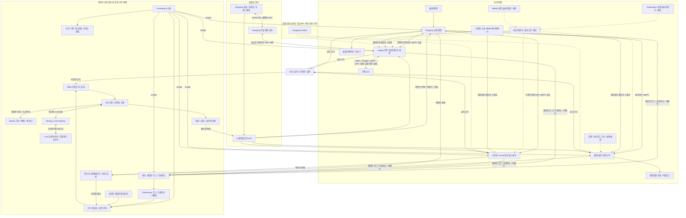
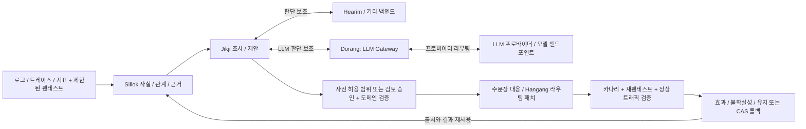
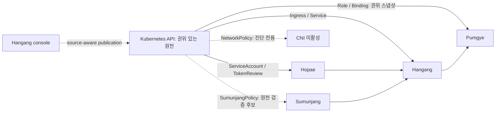

# Hangang Zero Trust

[English](README.md) · [설계 목차](docs/ko/README.md)

Hangang·Hopae·수문장을 기반으로 전체 제로트러스트 구조와 계약을 설계하는 저장소입니다.

- Hangang: 요청 집행, 리소스 접근 제어, 공통 관리 콘솔, 네이티브 로그인·로그아웃 진입점.
- Hopae: 사용자·세션·외부 인증 프로바이더. Google/OIDC 처리는 Hopae에 유지합니다.
- 수문장(기존 Guard): IP/CIDR/ASN 제어와 네트워크 위험 근거.
- 카탈로그·분류 엔진: API·리소스·데이터의 정보등급과 정책 속성.
- 품계: 서비스별 역할·권한·정보등급·사용자/IP 매트릭스와 결정적 권한 판단. 코어와 서버 크레이트를 분리하며, 호패·수문장과 함께 독립 서버로 배포하는 구조입니다. 인증된 native/gRPC 분산 체인과 통합 콘솔의 실제 4Pod Kubernetes 검증이 통과했습니다. 전체 혼합 신원·fleet 검증은 남아 있습니다.
- 장부: 별도 로그·트레이스 수집/조회 및 ClickHouse 연동.
- 기존 사초: 모니터링·상태·알림. 품계 권한 관리와 함께 향후 통합을 설계합니다.
- Sillok: 제로트러스트 온톨로지와 근거·관계·출처.
- Jikji: 자동·반자동 조사·제안·실행과 검증된 결과 재사용.
- Dorang(도랑): LLM Gateway, 모델·프로바이더 연결과 요청 라우팅.

현재는 **설계 문서와 계약 예제**입니다. 전체 구현 완료나 운영 검증을 의미하지 않습니다.
단말·워크로드는 추가 고민이 필요한 항목으로 남깁니다.

문서는 영어가 기준이며 한국어 번역을 함께 관리합니다.

온톨로지 엔진은 Sillok, 자동·반자동화 핵심 엔진은 Jikji를 사용합니다.
펜테스트 근거를 Guard 대응 및 Hangang 라우팅 패치로 연결하는
[통합 설계](docs/ko/AUTOMATION.md)를 추가했습니다. 런타임 연결은 구현 예정입니다.

[폐쇄 루프 설계](docs/ko/FEEDBACK_LOOP.md)에 로깅·트레이싱·모니터링·펜테스트를
온톨로지 기반 대응과 결과 재사용으로 연결하는 구조를 기록했습니다.

## 전체 구조

Sillok·Jikji는 제어 경로에서 동작합니다. 일반 요청은 분석·온톨로지 추론·LLM·펜테스트를
기다리지 않으며, 정책 쓰기 권한은 각 도메인 API에 유지합니다.

## 보안 피드백 루프

관측·제안·권한 확인·적용·검증을 구분합니다. 스캔 대상과 프로브 예산은 명시된 범위 안에
유지하며, 롤백은 중간의 다른 변경을 보존합니다. 검증된 결과는 다음 조사에 재사용할 근거이며
자동으로 전역 룰의 적용 권한이 되지는 않습니다.

## Dorang LLM 게이트웨이

[Dorang(도랑)](https://github.com/ziozzang/dorang)을 패키지 구조의 LLM Gateway로
배치합니다. Jikji의 LLM 보조 흐름은 Dorang을 통해 모델·프로바이더에 연결하고,
Hearim은 별도의 판단 백엔드로 유지합니다. 실제 통합은 설계 단계입니다.
리소스 권한 판단과 정책 게시 권한은 해당 도메인에 유지하며, 모델 호출은 제한된
제어 경로에서 신원·서비스 권한·근거 최소화·감사를 적용합니다.

## Hearim 판단 백엔드

[Hearim(헤아림)](https://github.com/ziozzang/hearim)을 Jikji가 활용하는 지능·판단
백엔드 중 하나로 선정합니다. 문서화된 `POST /v1/systemone`의 Choice / Score / Noul과
logprob 기반 후보 분포를 판단 보조에 활용하며 다른 백엔드도 함께 사용할 수 있습니다.
실제 어댑터 통합은 구현 예정입니다. Sillok 온톨로지나 Jikji 실행 조율을 대체하지 않습니다.

모델·백엔드·판단 기준 리비전, 입력 근거 해시와 스코어링 진단을 보존하고 입력 최소화·
기한·동시성·테넌트 격리를 적용합니다. 후보 확률과 엔트로피 신뢰도는 보정된 공격 위험도나
정책 적용 권한이 아닙니다. 후보 누락/장애는 판단 불가 또는 검토 대상으로 처리하며
자동 허용으로 바꾸지 않습니다. 실제 변경의 권한·CAS·감사는 독립적으로 검증합니다.
일반 요청마다 추론 의존성을 추가하지 않으며, 재현 가능한 fixture·실패 응답·보정 근거·
개인정보 격리를 검증해야 합니다.

내장 Hopae 관리 화면은 명시적으로 Hangang 콘솔 권한을 따를 수 있으며 로컬 로그인
아래에 Hopae SSO 버튼을 제공합니다. 계정 매핑·요청/세션 검사·소유권 경계는
[ADR 0009](docs/ko/ADR_0009.md)에 기록했습니다.

[품계 / Pumgye ownership and implementation plan](docs/adr/0010-pumgye-ownership.md) · [한국어](docs/ko/0010-pumgye-ownership.md)

[Pumgye integration qualification](docs/PUMGYE_QUALIFICATION.md) · [한국어](docs/ko/PUMGYE_QUALIFICATION.md)

[스케일아웃 설계](docs/ko/0013-snapshot-membership-scaleout.md)에 메모리 스냅샷·도메인 DB 백본·lease 멤버십·Hangang 풀/구독 의무를 기록했습니다. 실제 fleet 구현·검증은 진행 예정입니다.

[Kubernetes·IAM 원천 연동](docs/ko/0015-kubernetes-iam-authority.md): 한강 Ingress,
호패 TokenReview, 품계의 권위 있는 RBAC 스냅샷이 구현되어 있습니다. 신규 수문장
네이티브 정책 CRD 원천은 독립 실제 클러스터 검증을 통과했으며 전체 체인·릴리즈는
별도 진행합니다. 표준 NetworkPolicy 진단은 CNI 집행을 의미하지 않습니다.

[도메인 판정 코어와 메타데이터 어댑터](docs/ko/0016-decision-core-metadata-adapters.md) — DB 원천 메모리 스냅샷, Kubernetes 역방향 판정과 PostgreSQL 연동 제안. 실록은 선택 사항이며 새 어댑터는 미구현입니다.

[구성요소 이미지 패키징](docs/ko/PACKAGING.md)은 검증한 정적 파일을 패키징합니다. 로컬 이미지는 K8s/운영 배포의 완료를 뜻하지 않습니다.

[네 서비스 K8s 기능 검증](docs/ko/KUBERNETES_WORLD_QUALIFICATION.md)은 실제 API 요청 체인·Pod/PVC 교체·장애 거부를 기록합니다. 전체 관리자/공급자 및 K8s 인증 위임은 남아 있습니다.

[네이티브 관측 적용과 릴리즈](docs/ko/2026-10-15-native-observed-adoption.md)에
한강 0.3.6·호패 0.0.8·품계 0.1.7의 정확한 서명 후보, 기존 수문장 0.3.5, 실제 독립
호스트/Kubernetes/브라우저 검증과 내부 반영을 기록했습니다. 신규 수문장 원천은
별도 후속으로 추적합니다.
