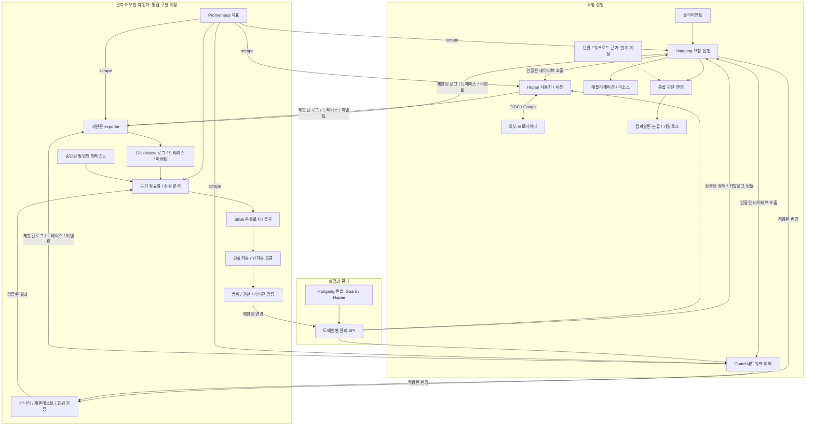
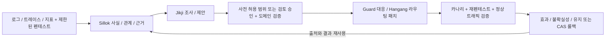

# Hangang Zero Trust

[English](README.md) · [설계 목차](docs/ko/README.md)

Hangang·Hopae·Guard를 기반으로 전체 제로트러스트 구조와 계약을 설계하는 저장소입니다.

- Hangang: 요청 집행, 리소스 접근 제어, 공통 관리 콘솔, 네이티브 로그인·로그아웃 진입점.
- Hopae: 사용자·세션·외부 인증 프로바이더. Google/OIDC 처리는 Hopae에 유지합니다.
- Guard: IP/CIDR/ASN 제어와 네트워크 위험.
- 카탈로그·분류 엔진: API·리소스·데이터의 정보등급과 정책 속성.
- 통합 판단 엔진: 신원·네트워크·리소스·확인 가능한 단말/워크로드 근거를 결합합니다.
- 관측 exporter: Prometheus 지표, ClickHouse 로그·트레이스·이벤트 분석.
- Sillok: 제로트러스트 온톨로지와 근거·관계·출처.
- Jikji: 자동·반자동 조사·제안·실행과 검증된 결과 재사용.

현재는 **설계 문서와 계약 예제**입니다. 전체 구현 완료나 운영 검증을 의미하지 않습니다.
단말·워크로드는 추가 고민이 필요한 항목으로 남깁니다.

문서는 영어가 기준이며 한국어 번역을 함께 관리합니다.

온톨로지 엔진은 Sillok, 자동·반자동화 핵심 엔진은 Jikji를 사용합니다.
펜테스트 근거를 Guard 대응 및 Hangang 라우팅 패치로 연결하는
[통합 설계](docs/ko/AUTOMATION.md)를 추가했습니다. 런타임 연결은 구현 예정입니다.

[폐쇄 루프 설계](docs/ko/FEEDBACK_LOOP.md)에 로깅·트레이싱·모니터링·펜테스트를
온톨로지 기반 대응과 결과 재사용으로 연결하는 구조를 기록했습니다.

## 전체 구조

Sillok·Jikji는 제어 경로에서 동작합니다. 일반 요청은 분석·온톨로지 추론·LLM·펜테스트를
기다리지 않으며, 정책 쓰기 권한은 각 도메인 API에 유지합니다.

## 보안 피드백 루프

관측·제안·권한 확인·적용·검증을 구분합니다. 스캔 대상과 프로브 예산은 명시된 범위 안에
유지하며, 롤백은 중간의 다른 변경을 보존합니다. 검증된 결과는 다음 조사에 재사용할 근거이며
자동으로 전역 룰의 적용 권한이 되지는 않습니다.
