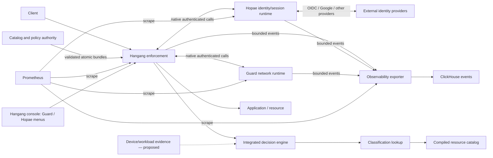

# Hangang Zero Trust

[한국어](README.ko.md) · [Design index](docs/README.md) · [Roadmap](docs/ROADMAP.md)

The architecture and contract repository for a zero-trust backbone built around
[Hangang](https://github.com/ziozzang/hangang),
[Hopae](https://github.com/ziozzang/hopae), and
[Guard](https://github.com/ziozzang/hangang-guard).

Hangang enforces admission and resource policy. Hopae owns user identity,
sessions and external authentication providers. Guard owns network controls and
network risk. Catalog/classification and integrated decisions add resource and
data context. An exporter connects bounded telemetry to Prometheus and ClickHouse.

**This repository contains design proposals, example contracts and validation,
not a shipped full-stack implementation.** Device and workload evidence needs
further design. Existing component capabilities and pending integration work
are tracked separately; a diagram is not a production assurance claim.

## System view



Read [Architecture](docs/ARCHITECTURE.md),
[Catalog](docs/CATALOG.md), [Classification engine](docs/CLASSIFICATION.md),
[Integrated decisions](docs/DECISIONS.md), [Native identity integration](docs/IDENTITY.md),
[Console plugins](docs/CONSOLE.md), [Runtime protocols](docs/PROTOCOLS.md),
[Observability](docs/OBSERVABILITY.md), and [Device/workload questions](docs/DEVICES.md).

## Validate the draft contracts

```sh
python3 -m venv .venv
.venv/bin/pip install -r requirements-dev.lock
.venv/bin/python tools/validate_contracts.py
```

Schema validity is only one check. The validator also checks cross-document
references and rejects representative unsafe bundles. Authorization enforcement,
HTTP/native parity, revocation, parser and performance qualification remain
implementation gates. All examples use reserved domains and synthetic identities.

Sillok is the selected zero-trust ontology engine. Jikji is the main automatic
and semi-automatic orchestration engine. Scoped pentest evidence feeds Guard
mitigations and validated Hangang routing patches; see
[Ontology and security automation](docs/AUTOMATION.md). Integration is planned.

[Closed-loop design](docs/FEEDBACK_LOOP.md) connects logging, distributed tracing,
monitoring and scoped pentesting to ontology-backed action and verified outcome reuse.
