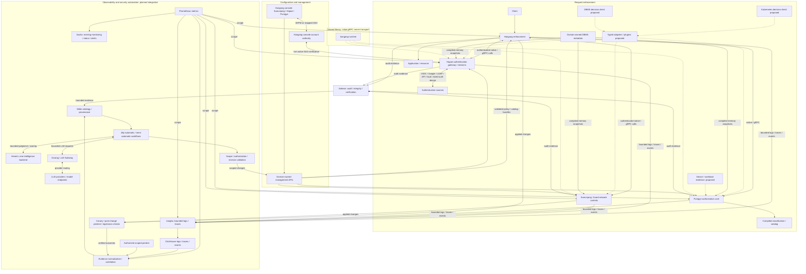
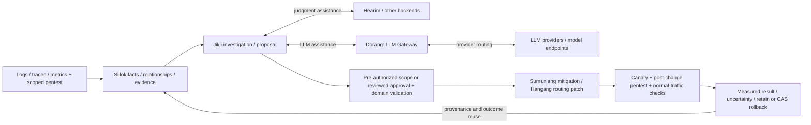
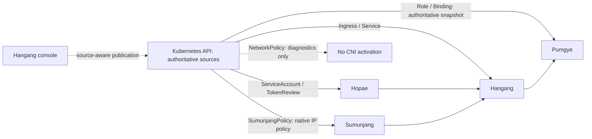

# Hangang Zero Trust

[한국어](README.ko.md) · [Design index](docs/README.md) · [Roadmap](docs/ROADMAP.md)

The architecture and contract repository for a zero-trust backbone built around
[Hangang](https://github.com/ziozzang/hangang),
[Hopae](https://github.com/ziozzang/hopae), and
[Sumunjang](https://github.com/ziozzang/sumunjang).

Hangang enforces admission and resource policy. Hopae owns user identity,
sessions and external authentication providers. Sumunjang (the Guard component)
owns network controls and risk evidence. Pumgye owns deterministic service roles,
permissions, information classes and user/IP authorization matrices. The required
architecture deploys Hopae, Sumunjang and Pumgye as independent servers; Pumgye
core and server are separate crates. The authenticated native/gRPC distributed chain and integrated console have passed
actual four-Pod Kubernetes qualification; broader mixed-identity and fleet gates
remain open. Jangbu, existing Sacho, Sillok and Saheon observability/audit
integration remain design work, with Prometheus and ClickHouse connections.

**This repository contains design proposals, example contracts and validation,
not a shipped full-stack implementation.** Device and workload evidence needs
further design. Existing component capabilities and pending integration work
are tracked separately; a diagram is not a production assurance claim.

## System view



Request enforcement uses bounded native calls and compiled policy. Sillok and
Jikji operate on the control plane; ordinary requests do not wait for analytics,
ontology reasoning, LLM execution or pentesting. Domain APIs retain write authority.

## Security feedback loop



Observe, propose, authorize, apply and verify are distinct stages. Pentest targets
and probe budgets remain explicitly scoped. Rollback preserves intervening changes;
verified outcomes become reusable evidence, not automatically authorized global rules.


Read [Architecture](docs/ARCHITECTURE.md),
[Catalog](docs/CATALOG.md), [Classification engine](docs/CLASSIFICATION.md),
[Integrated decisions](docs/DECISIONS.md), [Native identity integration](docs/IDENTITY.md),
[Console plugins](docs/CONSOLE.md), [Runtime protocols](docs/PROTOCOLS.md),
[Observability](docs/OBSERVABILITY.md), [Ontology and automation](docs/AUTOMATION.md),
[Feedback loop](docs/FEEDBACK_LOOP.md), and [Device/workload questions](docs/DEVICES.md).

## Validate the draft contracts

```sh
python3 -m venv .venv
.venv/bin/pip install -r requirements-dev.lock
.venv/bin/python tools/validate_contracts.py
```

Schema validity is only one check. The validator also checks cross-document
references and rejects representative unsafe bundles. Authorization enforcement,
HTTP/native parity, revocation, parser and performance qualification remain
implementation gates. All examples use reserved domains and synthetic identities.

Sillok is the selected zero-trust ontology engine. Jikji is the main automatic
and semi-automatic orchestration engine. Scoped pentest evidence feeds Guard
mitigations and validated Hangang routing patches; see
[Ontology and security automation](docs/AUTOMATION.md). Integration is planned.

[Closed-loop design](docs/FEEDBACK_LOOP.md) connects logging, distributed tracing,
monitoring and scoped pentesting to ontology-backed action and verified outcome reuse.

## Dorang LLM gateway

[Dorang](https://github.com/ziozzang/dorang) is the LLM Gateway in the package
architecture. Jikji's LLM-assisted workflows use Dorang to reach model/provider
endpoints; Hearim remains a separate judgment backend. This integration is planned.
Dorang does not own resource authorization or policy publication. Model calls stay
on the bounded control plane, with identity, service permissions, evidence
minimization and audit enforced by the surrounding zero-trust components.

## Hearim judgment backend

[Hearim (헤아림)](https://github.com/ziozzang/hearim) is selected as one of the
background intelligence/judgment backends used by Jikji. Its documented
`POST /v1/systemone` interface supports Choice / Score / Noul questions and
logprob-derived candidate distributions. This is judgment assistance, not the
resource-policy authority, an authenticated fact source or a replacement for
Sillok/Jikji. Other backends remain possible. Integration is planned.

An adapter must pin model/backend and rubric revisions, minimize evidence sent,
bound deadlines/concurrency and retain question/evidence digests and scoring
diagnostics. Probability and entropy confidence are not calibrated attack risk
or permission to apply a patch. Missing candidates/backend failures yield an
unavailable or review outcome; they cannot silently become an allow decision.
Domain authorization, CAS and audit remain mandatory for every actual change.
Qualification requires deterministic fixtures, malformed/unavailable results,
calibration evidence and tenant/privacy isolation. No per-request inference
dependency is introduced into ordinary enforcement.

The embedded Hopae page can explicitly follow Hangang console authority, with a
Hopae SSO button below local account login. See [ADR 0009](docs/adr/0009-console-authority-sso.md)
for mapping, request/session checks and ownership boundaries.

[품계 / Pumgye ownership and implementation plan](docs/adr/0010-pumgye-ownership.md) · [한국어](docs/ko/0010-pumgye-ownership.md)

[Pumgye integration qualification](docs/PUMGYE_QUALIFICATION.md) · [한국어](docs/ko/PUMGYE_QUALIFICATION.md)

[Scale-out design](docs/adr/0013-snapshot-membership-scaleout.md) records memory snapshots, domain DB backbones, leased membership and Hangang pool/watch obligations. Implementation and fleet qualification remain pending.

[Kubernetes and IAM source integration](docs/adr/0015-kubernetes-iam-authority.md):
Hangang Ingress, Hopae TokenReview and Pumgye authoritative RBAC snapshots are
implemented. Sumunjang 0.3.6 native policy CRD authority has passed both source/default
four-service Kubernetes and browser qualification and is published. Standard
NetworkPolicy diagnostics do not establish CNI enforcement.



[Domain decision cores and metadata adapters](docs/adr/0016-decision-core-metadata-adapters.md) — database-backed memory snapshots, inbound Kubernetes decisions and proposed PostgreSQL integration. Sillok is optional; these new adapters are not shipped.

[Component image packaging](docs/PACKAGING.md) packages qualified static artifacts; local images do not imply Kubernetes or production rollout.

[Four-service Kubernetes functional qualification](docs/KUBERNETES_WORLD_QUALIFICATION.md) records the selected actual API request chain, Pod/PVC replacement and failure gates; full administrator/provider and inbound Kubernetes delegation remain open.

[Native observed adoption and releases](docs/reviews/2026-10-15-native-observed-adoption.md)
records the exact signed Hangang 0.3.6 / Hopae 0.0.8 / Pumgye 0.1.7 candidates,
retained Sumunjang 0.3.5, subsequent native Sumunjang 0.3.6, actual independent-host/
Kubernetes/browser gates and internal adoption.


[Hangang 0.3.7 follow-up qualification and adoption](docs/reviews/2026-10-15-native-observed-adoption.md#subsequent-hangang-037-publication-and-adoption) records the subsequent network-cache lifetime fix, preserved failures and actual publication/internal rollout.


[Hopae 0.0.9 composition publication and adoption](docs/reviews/2026-10-15-native-observed-adoption.md#hopae-009-composition-publication-and-internal-adoption)
records the subsequent qualified Service identity composition release. The
[current Astra adoption audit](docs/reviews/2026-10-15-astra-adoption-audit.md)
distinguishes completed runtime gates from unfinished administrator UX. Hangang
0.3.8 layout/operation-reference source has passed workspace/Clippy/browser checks;
its exact static/K3s/internal rollout remains in progress.
