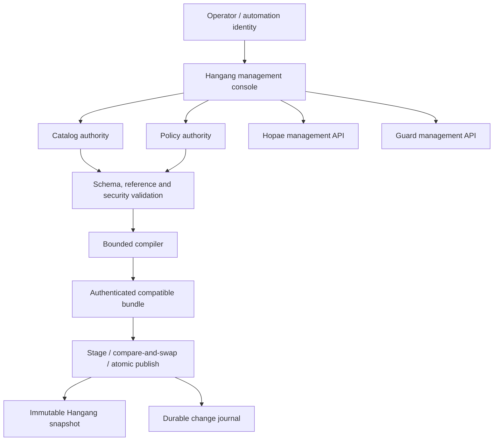
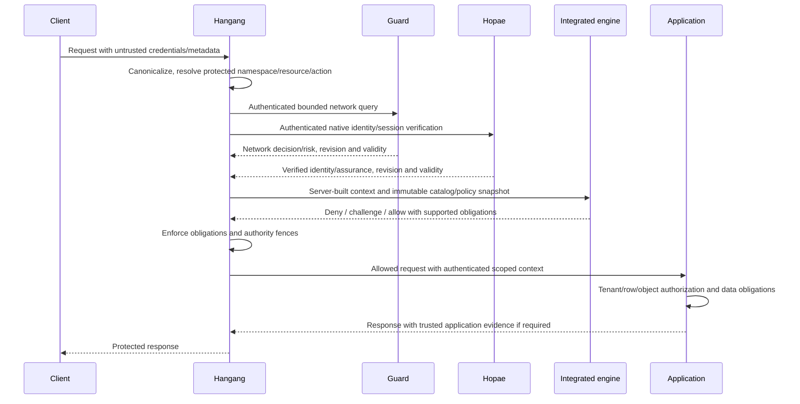

# Architecture

[한국어](ko/ARCHITECTURE.md) · [Index](README.md)

Status: proposed cross-component architecture, grounded in existing components.

## Ownership

| Domain | Writer / authority | Consumers |
| --- | --- | --- |
| Hosts, routes, listeners, upstreams, enforcement | Hangang | Console, compiled classifier |
| Providers, users, session validity, authentication strength | Hopae | Hangang and delegated console |
| IP pools, ASN/GeoIP, suspicion, network rules | Guard | Hangang and console |
| Classification vocabulary, resource labels and constraints | Catalog authority | Compiler, Hangang, applications |
| Resource access policy and obligation definitions | Policy authority | Integrated engine |
| Runtime decisions | Hangang enforcement | Applications and bounded telemetry |
| Telemetry projection | Exporter | Prometheus, ClickHouse, console |

A console is an interface to authorities, not a second writer to their tables.
The catalog does not rewrite routing/backends. Hopae does not become a routing
administrator; Guard does not become an account store. The exporter has no
policy mutation credential. Every field has one owning writer.

## Control plane

The first implementation can reuse Hangang's configuration authority and CAS
for bounded catalog/policy definitions. A separate controller is justified when
approval, federation or independent compilation becomes necessary. Storage
location does not establish trust: issuers, schema versions, content hashes and
activation rules do. Catalog and policy updates publish as one compatible bundle.
A node must never combine a new policy with an incompatible old label set.

## Data plane

Independent remote queries may run concurrently only after protected namespace
admission, bounded resource resolution and credential-source selection. Known
network denials can terminate early. A network allow never substitutes for
identity/resource authorization. Public resources need explicit anonymous policy;
`public` classification alone does not grant access.

The ordinary path uses immutable compiled structures. No ClickHouse write,
provider discovery or LLM invocation is implicit in every request. Hopae may
perform its own required provider/session checks under an explicit bounded
contract. Decision results carry freshness and policy provenance.

## Current versus planned

Existing: Hangang routing/resource primitives and several native identity/TLS
features; Hopae provider/session engine and administration; Guard native HTTP/TCP,
network rules, GeoIP and signed update mechanisms. Prototype: console package
loading and delegated Guard administration. Planned: shared catalog schema,
classification compiler, integrated multi-source decisions, Hopae native fast
transport, native login/logout facade and unified observability exporter.
Device/posture federation remains an open design. No full-stack compliance claim
is made from this inventory.

References: [NIST architecture roles](https://pages.nist.gov/zero-trust-architecture/VolumeB/architecture.html),
[CISA maturity model](https://www.cisa.gov/sites/default/files/2023-04/zero_trust_maturity_model_v2_508.pdf).

## Ontology and remediation control plane

Sillok owns the zero-trust ontology projection and provenance; Jikji owns
automation workflow state. Scoped pentest evidence flows through Sillok and Jikji
to domain-authorized Guard changes and Hangang routing patches. Domain fact
ownership above remains unchanged. See [Automation](AUTOMATION.md) for scoped
automatic/approved execution, partial-failure recovery and CAS rollback.
