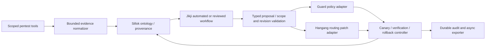

# Ontology and security automation

[한국어](ko/AUTOMATION.md) · [Index](README.md)

Status: accepted component selection; integration contracts and runtime adapters
remain proposed. Sillok is under development. This document does not claim a
working Sillok/Jikji/Guard/Hangang remediation pipeline.

## Responsibility

**Sillok is the zero-trust ontology engine.** It represents resource/catalog
relationships, information classes, principals, network assets, findings,
policy constraints and change provenance. Domain services remain the authorities
for their own facts; ontology assertions retain issuer, tenant, observation time,
expiry, evidence digest and source revision. Inferred relationships never silently
become verified identity, an active route or an approved information downgrade.

**[Jikji](https://github.com/jikji-labs/jikji) is the main automation and
semi-automation engine.** It orchestrates evidence collection, reasoning,
proposal generation, review, scoped execution and verification. Its existing
ontology tools do not replace Sillok as the authoritative zero-trust ontology
backend; a Sillok adapter must expose only the supported, bounded query subset.
The current Sillok source describes restricted SELECT/ASK and experimental
formats; full SPARQL, persistent catalog/WAL and production federation must not
be assumed. Pin adapter capabilities and snapshot revisions explicitly.

Pentest tools produce evidence. Guard owns resulting network policy and temporary
mitigations. Hangang owns routing patches and their validation/activation.
Hopae continues to own provider, user and session facts. ClickHouse is an event
projection, not the ontology authority or the change journal.

## Closed-loop flow

Adapters are proposed interfaces, not invented existing endpoints. Prefer native
validated APIs over arbitrary shell execution or direct database writes.

1. Authorize a scan job with an explicit tenant, asset/route IDs, allowed targets,
   probe profile, deadline, concurrency and bandwidth budget. Resolve approved
   targets at execution and constrain redirects/re-resolution to the same scope.
2. Normalize bounded output into a finding with tool/version, evidence digest,
   target binding, severity, confidence, observation/expiry and scan identity.
   Treat tool text and web responses as untrusted data, including prompt injection.
3. Record source facts in Sillok. Jikji correlates catalog, route and Guard evidence
   at pinned revisions, and proposes typed changes with a justification.
4. Independently validate targets, tenant boundaries, patch field allowlists,
   revision preconditions, expiry and expected impact. Agent reasoning alone
   cannot authorize a write.
5. Record durable intent and execute through domain-owned adapters using narrowly
   scoped credentials and stable idempotency keys. Hangang applies its validated
   routing patch/CAS mechanism; Guard validates its policy update.
6. Verify route availability, authentication requirements and mitigation results.
   Publish outcomes and source revisions. Re-scan within budget; avoid an
   uncontrolled scan/mitigation feedback loop.

## Automatic and semi-automatic execution

An operator-configured automation policy can pre-authorize bounded, reversible
changes, such as a temporary Guard block on an explicitly owned test asset or a
validated route mitigation within an approved field/target allowlist. Confidence
alone is insufficient. Scope, evidence freshness, maximum affected assets,
expiry, canary checks and a rollback plan are all required.

Changes outside that policy enter Jikji's durable approval workflow. Approval is
bound to the exact proposal digest, actor, scope and expiry; edited proposals
require reevaluation. Approval never skips domain-side authorization or CAS.
Protect management routes, authentication settings and break-glass access with
explicit restrictions. No unrestricted scanner, model or orchestrator key may
rewrite all Hangang routes.

## Failure and rollback

Guard and Hangang have independent writers: there is no assumed atomic commit
across services. A coordinator records each stage and orders changes according
to a validated safety plan. An ambiguous timeout requires querying applied state
before retry, using the same operation identity. A crash resumes from durable
state without replaying an already completed mutation.

Rollback is a new authorized CAS change against the observed applied revision.
Never restore a whole stale configuration over intervening operator changes.
If compensation conflicts, retain the safer bounded mitigation when policy
permits, stop further writes and surface the unresolved state. Automatic expiry
is also an authorized, revision-aware operation, not an unconditional deletion.

Sillok/Jikji outages stop new automation; they do not insert synchronous queries
or LLM calls into every ordinary request. Hangang continues its last validated
snapshot subject to its explicit expiry/failure policy. Hot enforcement uses
compiled policy; ontology reasoning and remediation stay on the control plane.

## Qualification backlog

- Versioned Sillok capability/query adapter and tenant/provenance isolation.
- Jikji tools for bounded evidence intake, proposal, approval and execution.
- Normalized finding and remediation contracts with adversarial validation.
- Guard and Hangang scoped patch adapters, journal and recovery state machine.
- Dry-run, automatic bounded change, reviewed change and rollback demonstrations.
- Tests for stale evidence/CAS, target escape, prompt injection, duplicate jobs,
  partial commit, restart recovery, revoked grants and rollback conflicts.
- Performance evidence that automation/export does not consume request budgets.
