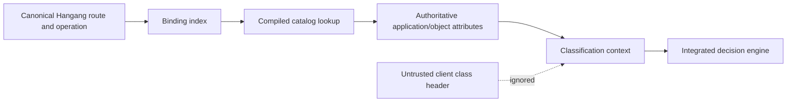

# Classification engine

[한국어](ko/CLASSIFICATION.md) · [Index](README.md)

Status: design prerequisite for integrated resource decisions.

## Two separate jobs

1. **Runtime resolution:** determine the resource, action, authoritative labels
   and obligations from an already validated snapshot and verified context.
2. **Classification assistance:** inspect metadata/content/patterns and propose
   labels for operator or application-owner review.

The runtime resolver is deterministic and bounded. Assistance may use a parser,
external scanner or LLM, but does not grant permission to relabel live resources.
User-requested prompt inspection remains an explicitly designed extension.

## Runtime pipeline

Inputs: active bundle identity, canonical route ID, resolved operation, verified
subject/tenant facts where required, and trusted application evidence. Outputs:
resource/action IDs, sensitivity/compartments, owner/application IDs, provenance,
missing-fact indicators, and references to supported obligations. A resolver
must not convert unknown evidence into a low sensitivity label.

Compile route/action keys to direct indices or bounded prefix structures, dedupe
label vectors and intern immutable identifiers. Validate overlaps and method
normalization once at publication. Avoid per-request regex compilation, database
queries, filesystem reads, scripting, network content crawls and LLM calls.
Resource-instance checks can have explicit bounded lookups only on resource
policies that require them. Their latency and failure behavior are separately
qualified.

## Label sources and precedence

The application owner provides baseline labels through the catalog authority.
Verified object metadata can increase constraints. It can decrease constraints
only through a reviewed, authorized downgrade policy. Categories compose; they
are not averaged into a score. A route rename, host alias or provider claim cannot
implicitly override catalog ownership. Conflicting authoritative sources deny
or refuse bundle activation, rather than last-writer-wins on requests.

## Optional content classification

Treat content inspection as a configured operation with a parser/content-type
contract, input limit, timeout and budget. Inspect streaming content only when
one can preserve framing and enforce the obligation without forwarding protected
bytes first. Otherwise use application classification or asynchronous analysis.
Do not make `buffer entire request/response` the default at 100,000 QPS.

A content-label proposal includes source, model/rule version, confidence,
evidence references, resource scope, input redaction, expiry and review status.
LLM output is attacker-influenced data. Validate structured output and isolate
prompts/tools; do not let it edit allowlists, downgrade labels, expand IP/ASN
blocks, or issue credentials. The reviewed catalog revision is the enforcement
source, not the model's free text.

## Proposal lifecycle

Observed → proposed → owner review → impact simulation → approved → compiled →
shadow evaluation → published. Rejected/expired proposals have no enforcement
power. Differences from current labels are auditable. A service account that
submits proposals does not hold catalog publication permission.

## Acceptance cases

- Protected resources with missing/unknown labels deny.
- A client-supplied class, forged identity header or transformed path cannot
  reduce required controls.
- Overlapping bindings and unknown actions fail compilation/resolution.
- Dynamic tenant/object ownership is not inferred from URL syntax.
- Body transforms cannot reuse a proof for earlier bytes.
- Mixed-class results preserve all constraints; unsupported redaction denies.
- Bounded classification resolution is measured separately and within the full
  Hangang → Hopae/Guard → application request path.
