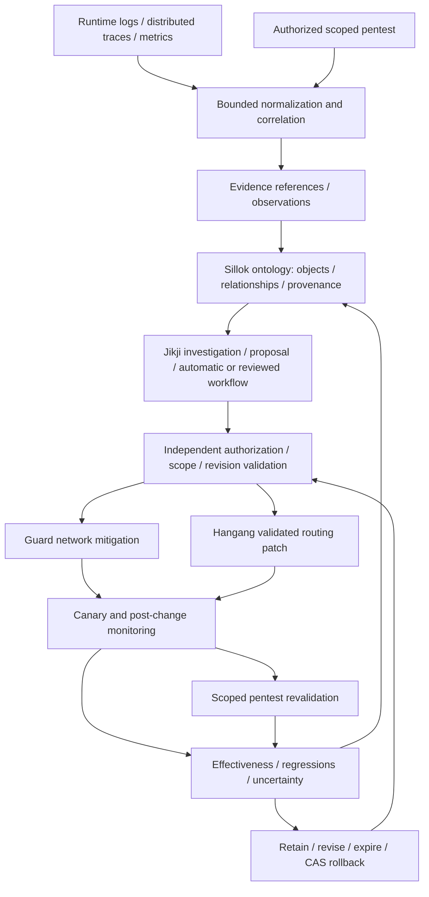

# Observability, ontology and pentest feedback loop

[한국어](ko/FEEDBACK_LOOP.md) · [Index](README.md)

Status: accepted design direction; adapters, correlation and execution qualification
remain planned. This is an operational closed loop, not a shipped implementation
or a claim of equivalence to any commercial platform.

## End-to-end loop

The loop must connect observation to a concrete controlled action, then retain
its measured result. A dashboard or model-generated narrative alone is not a
completed feedback loop. Pentesting is required both as an evidence source and
as a bounded verification stage after applicable changes. No scan is authorized
merely because an asset appears in telemetry or an ontology relationship.

## Storage and semantic ownership

| Component | Role |
| --- | --- |
| ClickHouse | Bounded logs, trace/span records, security events and detailed queries |
| Prometheus | Low-cardinality time-series metrics, SLOs and alerting |
| Sillok | Semantic objects, relationships, derived summaries and provenance links |
| Jikji | Durable investigation, proposals, approval and execution workflow |
| Guard | Authoritative network rules, risk facts and mitigation changes |
| Hangang | Authoritative routes, validated patch activation and enforcement |
| Hopae | Authoritative users, providers, sessions and authentication assurance |

Do not copy every log line or sample into Sillok. Materialize useful facts,
aggregates and relationships with bounded cardinality and references to their
source records. Trace/request IDs may correlate authorized event queries; they
must not become unbounded Prometheus labels. A metric anomaly is not proof of
an attack, and graph proximity is not proof of shared identity or authorization.

Distinguish observed facts, derived hypotheses, approved policy, actual applied
state and verified outcomes. Every assertion records tenant, issuer, observation
window, source revisions, evidence digest, validity and confidence where relevant.
Contradictions and missing evidence remain explicit. Expired or retracted facts
cannot silently continue authorizing new actions. Derived claims retain their
input lineage so retraction can invalidate dependent proposals.

## Pentest lifecycle

A scan job needs explicit target ownership/scope, allowed probe profiles,
credentials, rate/concurrency/time budgets and an accountable execution identity.
Restrict DNS re-resolution and redirects to approved targets. Never expand to a
related host merely because a graph edge suggests it. Read-only/passive checks,
active verification and disruptive probes have distinct authorization profiles.

Normalize findings with scanner/version, job identity, asset/route binding,
severity, confidence, reproduction/evidence references and timestamps. Scanner
output is untrusted input, including prompt injection. A finding can propose
Guard controls or Hangang route changes; it cannot directly grant itself write
permission. Correlate findings with deployed revisions and real traffic evidence
before concluding that a mitigation is appropriate.

Post-change checks use the approved scope and profile again. Retain before/after
results, inconclusive tests and coverage gaps. A blocked scanner request alone
cannot prove that the underlying vulnerability is fixed. Distinguish temporary
network containment, route-level mitigation and an application-level repair.
Revalidation failure can trigger an authorized bounded correction or rollback,
not unrestricted escalation of probes.

## Outcome contract and reuse

Each remediation case links a stable case ID to observations, findings,
proposal digest, authorizing policy/approval, operation IDs, before/after revisions,
canary results, revalidation jobs and any rollback. Record uncertainty when an
acknowledgment or evidence is missing; query actual state before replaying writes.

Evaluate attack reduction alongside availability, latency, error rates,
authentication/authorization regressions, affected assets and false positives.
Compare compatible observation windows and record sampling/drop rates, baseline
changes and other simultaneous changes. Correlation alone does not establish
causal success. Define acceptance thresholds and stop conditions before execution.

Reuse outcomes as retrievable evidence for later Jikji investigations and policy
proposals. Do not automatically turn a successful local mitigation into a global
rule, or turn repeated model assertions into observed facts. Generalization needs
scope/tenant validation, evidence freshness and independent policy authorization.
Use cooldowns, maximum changes per window, TTLs and circuit breakers to prevent
self-reinforcing scan/mitigation loops.

## Safety and qualification

The [automation contract](AUTOMATION.md) governs automatic versus reviewed changes,
scoped credentials, durable intent, independent domain writers and CAS rollback.
The [observability contract](OBSERVABILITY.md) governs privacy, bounded ingestion,
loss accounting and asynchronous export. Exporters cannot mutate policy.
Sillok/Jikji/scanner outages suspend new automated actions and expose uncertainty;
ordinary Hangang enforcement follows its explicit snapshot validity/failure policy.
No ontology, analytics, LLM or pentest dependency is added to every request.

Acceptance demonstrations must cover a scoped finding, dry-run proposal, bounded
automatic change, reviewed change, post-change pentest, normal-traffic regression,
partial failure/restart, expiry and conflict-safe rollback. Adversarial tests include
cross-tenant correlation, target escape, poisoned tool output, stale/retracted
facts, duplicate cases, feedback amplification and misleading success signals.
