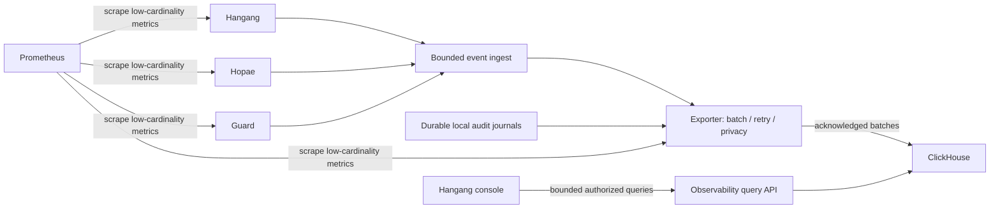

# Logging, monitoring and exporter design

[한국어](ko/OBSERVABILITY.md) · [Index](README.md)

Status: proposed independent exporter module/runtime; no analytics dependency in
ordinary admission. ClickHouse is an event analytics sink, not a policy authority.

## Signal classes

Metrics: counters/histograms/gauges for decisions, outcomes, dependency failures,
latency, pool occupancy, parser rejects, revocation, queue pressure, drops, retries,
spool space and sink lag. Prometheus labels use bounded component/route-template/
operation/outcome values. Never put user IDs, raw IPs, email, URLs with parameters,
resource-instance IDs or session/request IDs into metric labels.

Decision/security events: structured bounded records with event/request ID,
component instance, event type, result/reason code, resource/action, authority
revision vector, timing and minimal approved evidence. Where identity/IP evidence
is needed, define access, retention and hashing/pseudonymization policies. Hashing
is not automatically anonymization; keyed pseudonyms need rotation and clear
correlation scope. Do not retain request headers/bodies wholesale.

Management audit: exact actor and operation identity, target reference, previous/
next hashes, intent/outcome and uncertainty. Provider/session secrets, passwords,
cookies and raw Lua/request bodies are excluded. Sources record security-critical
write intent durably before accepted mutation, with bounded local storage.

## Request path and overload

Ordinary request processing updates atomic/bounded counters and tries a bounded
event queue. It never waits for ClickHouse, Prometheus or an LLM. Explicitly sampled
routine events can be dropped under a documented policy; drops must be measurable.
Reserve capacity and quotas for important security signals, while preventing an
attacker's deny flood from exhausting all memory or becoming unlimited storage.
Priority is not a guarantee of unlimited lossless event delivery.

Management audit uses a separate bounded durable journal. If local audit admission
is required and unavailable/full, reject the applicable mutation before dispatch.
A ClickHouse outage alone should not disable all decisions; exporter replays the
journal later. Define retention/checkpoint/prune rules before calling it reliable.
Transport queues and WALs have hard disk/age/byte limits, not endless retry promises.

## Export and ClickHouse

The exporter owns sink-specific credentials limited to insertion/query scopes.
Ingest uses authenticated producers, versioned event envelopes and bounded batch
sizes. Cap flush time, bytes, records, concurrent batches, retry count/backoff and
spool size. Preserve backpressure/drop/failure counters and report sustained lag.

Delivery is at-least-once when durable replay is enabled. Stable event IDs allow
queries to deduplicate; retries and ClickHouse merge behavior do not establish
exactly-once accounting. Use deduplicated audit views for security conclusions;
materialized aggregates need an explicit duplicate policy. Source metrics remain
authoritative for simple counters rather than counting duplicate analytics rows.

For async inserts choose acknowledged persistence behavior, including
`wait_for_async_insert=1`, rather than acknowledging merely an in-memory sink
buffer. Batch behavior and deduplication depend on schema/deployment and need
qualification. A server ack is not a substitute for local audit semantics.

The draft event schema and sample SQL describe columns/partition/retention
intent. Access controls, encryption, tenant filtering, retention, backups and
redaction have to be configured before operational ingestion. The console uses
a bounded query service, not browser-held ClickHouse credentials or arbitrary SQL.

## Dashboards and tests

Provide service health, decision latency/outcomes, auth failures/challenges,
network suspicion, classification misses, policy revisions, revocation lag,
exporter drops/backlog/sink failures and management-operation outcomes. Alerts
reference fixed thresholds/SLO budgets and sustained conditions. Low-cardinality
metrics must remain usable under attack.

Qualification: sink down, slow/rejected insert, replay after crash, duplicate
batches, malformed producer messages, sensitive-data fixtures, full spool, audit
capacity exhausted, and bounded 100k-QPS request-path overhead.

Primary references: [Prometheus metric/label naming](https://prometheus.io/docs/practices/naming/),
[Prometheus instrumentation](https://prometheus.io/docs/practices/instrumentation/),
[ClickHouse observability integration](https://github.com/ClickHouse/clickhouse-docs/blob/main/docs/use-cases/observability/build-your-own/integrating-opentelemetry.md).

## Ontology and action feedback

Logging, distributed tracing and monitoring feed the
[ontology and pentest feedback loop](FEEDBACK_LOOP.md). Sillok stores semantic
facts and provenance links; Jikji reuses verified outcomes to investigate and
propose scoped actions. Pentest before/after evidence and normal-traffic health
are both required to assess applicable remediation. Raw analytics storage remains
separate, and export credentials never gain policy mutation authority.
