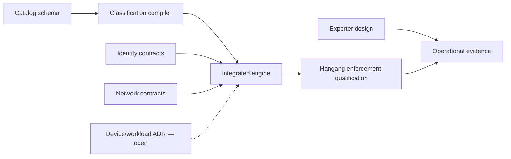

# Roadmap and delivery gates

[한국어](ko/ROADMAP.md) · [Index](README.md)

## Main integration track

1. Guard is a real Hangang sidebar menu, with the existing operator authority;
   use native embedding or a bounded adapter over the deployed admin API.
   Gate: real domain/browser flow, no second login, roles/revocation, audit and
   stale-result cleanup; preserve running data-plane routes.
2. Hopae is a native management menu, using an explicit scoped delegation API
   that respects Hopae grants/CSRF. Gate: users/session/events/status operations
   and real-actor audit; no service-key bypass of provider/user policy.
3. Hopae native protocol/client plus native Hangang login/logout integration.
   Gate: HTTP/native parity, bounded parsing, service authentication, expiry,
   revocation, cancellation, pooling, provider failure and realistic load.
4. Publish compatible versions after native build/security/integration review;
   signed activation follows component update mechanisms. No debug binary is
   substituted for the production routing process to demonstrate a menu.

## Cross-component design subtask

A. Catalog vocabulary, resource/action bindings, authoritative label sources,
   schema/reference validation and downgrade workflow.
B. Deterministic classification compiler/resolver and shadow evaluation.
C. Typed integrated policy evaluator with revision/freshness/obligation contracts.
D. Exporter with Prometheus metrics, ClickHouse events, bounded replay and audit.
E. Device/workload design only after environmental/assurance questions are resolved.

## Authorization model and Kubernetes package track (proposed)

Proposed by [ADR 0021](adr/0021-pumgye-authorization-model-revision.md) and
[ADR 0022](adr/0022-kubernetes-native-world-package.md); product-grade gates, not
proof-of-concept checks. Status: designed.

- **P0:** Pumgye policy v2 (principal/group/template/binding, deny, zone references,
  clearance ceilings, validity, explain with trace parity, v1→v2 converter and shadow);
  Hopae groups, membership projection, subject lifecycle feed, offline JWKS workload
  verification with tombstones; Sumunjang `NetworkZone`/`NetworkControl`;
  `world.hangang.dev` v1alpha1 CRDs and `hangang-world-controller` with signed snapshots,
  bounded staleness and fast revocation; Hangang Gateway API + `ProtectionPolicy` with
  client IP preservation; cert-manager mTLS; Helm/OCI charts with digest-pinned signed
  images. Gate: chart-installed functional acceptance on the designated remote k3s
  after a fresh verified backup; no load tests until functional gates pass.
- **P1:** HA (PostgreSQL, N≥2, PDBs), upgrade/rollback, v1beta1 + conversion, CNI policy
  generation, SPIFFE SVIDs, console and decision events (ADR 0019/0020), backup/restore
  drill, Gateway API conformance.
- **P2:** JIT access and reviews, multi-cluster World, east-west L7, SAR authorizer
  redesign, 10k/100k full-chain load qualification.

## Concrete next deliverables

- Native plugin manifest/API/lifecycle specification and adversarial fixtures.
- Hopae delegated-administration ADR and scope/actor/CSRF compatibility tests.
- Provider-independent verify contract and golden HTTP/native corpus.
- Reserved native auth facade with return-target/logout-scope tests.
- Catalog + policy + bundle schemas, valid and rejected examples.
- Classification resolver prototype, resource binding collision tests and measured
  compile/lookup limits.
- Exporter event schema and sink-spool/privacy/failure qualification.
- Integrated policy decision matrix and traceable publication/rollback journal.

## Performance acceptance

10,000 and 100,000 decisions/sec are qualification targets. Report achieved
throughput, workload, CPU/RSS, p50/p95/p99, error/drop counts and revocation lag.
Measure each component and the full path; distinguish warm/cold session work,
provider interaction, TLS, saturation and concurrent durable admin changes.
Telemetry/classification must have explicit overhead budgets. No target is
considered achieved by transport-only counters without authorization semantics.

## Status rules

Record planned → designed → prototype → security reviewed → qualified → released
→ operationally observed. Record actual evidence and unresolved defects. Do not
mark a milestone complete because a document or route placeholder exists.
