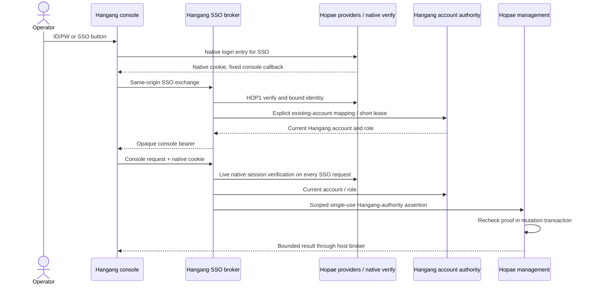

# ADR 0009: one console authority with Hopae SSO

Status: implemented; deployment evidence is tracked in TODO. [한국어](../ko/ADR_0009.md)

The integrated Hopae management page follows Hangang authentication and roles.
Operators should not have to authenticate a second time to manage an embedded
module. Google/OIDC and identity/session ownership stay in Hopae. Hangang account
roles remain the authority for its console, including users authenticated by SSO.

Choose two explicit delegation modes. The default native mode retains the earlier
independent Hopae grant/handle/freshness/AAL policy. The new `hangang` mode accepts
only signed Hangang administrators on the fixed management allowlist; it neither
creates Hopae grants nor impersonates a native Hopae user. Mode is part of the
signature. Durable nonce admission, exact request binding and a proof younger
than five seconds remain required. The write transaction validates current key,
expiry and issuer-derived actor/session binding. Native standalone management
still applies its own policy. Unified assurance follows Hangang policy; response
metadata does not invent native login time/AAL. Audit retains both issuer and actor.

SSO is an opt-in native console broker configuration. Map stable opaque Hopae IDs
to existing enabled Hangang usernames; never auto-link email/display names or
create roles from a provider claim. Each SSO request requires the live Hopae cookie
and original client IP/UA and re-enters native verification. A random opaque browser
bearer cannot authenticate directly at the underlying Hangang API. The broker uses
private five-second account leases, reused for at most one second; Hangang checks
its local role and enabled state. A system-only lease endpoint cannot be used by an
ordinary administrator account or through the public console adapter. Credentials
and mapping configuration stay private; discovery contains only a provider label
and fixed login path. Same-origin custom-header POST exchanges require an empty
JSON object and reject ambiguous headers/cookies. Provider tokens stay in Hopae.

Console logout revokes its opaque bearer/current lease. Other Hopae applications
are not globally logged out. Adapter restart invalidates opaque sessions; a new
SSO exchange can reuse the retained native Hopae login. Distributed authorities
cannot atomically retract an operation another service has already accepted.

Evidence: real Hangang account/SSO broker test with an owned HOP1 identity fixture
covers mapping, revocation on the next request, cookie binding, origin rejection,
parent-API bypass and logout. Browser tests cover button placement/callback/current
roles/restoration. Real Hopae scenarios cover default-mode regression, unified
reads/mutations, mode isolation, expiry, nonce replay, unsigned rejection and audit.
End-to-end throughput qualification remains independent of this console work.
