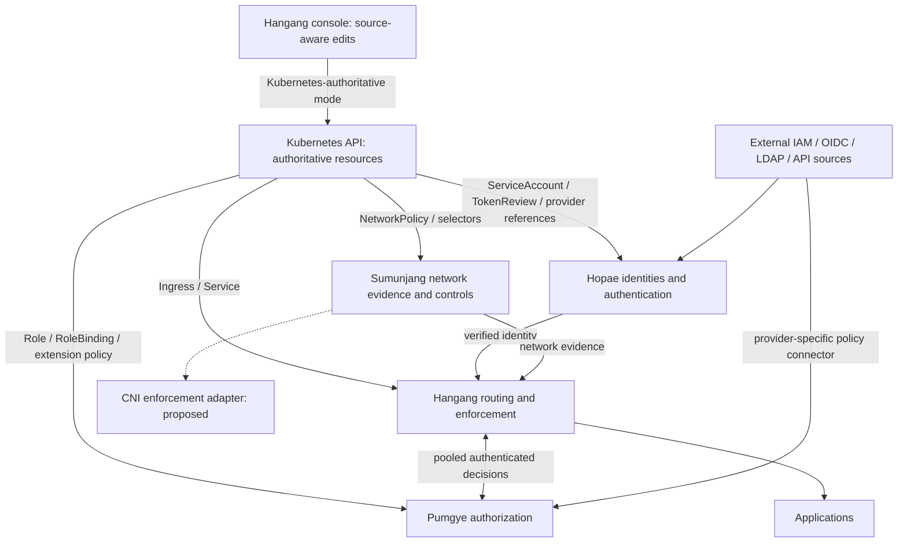

# ADR 0015: Kubernetes and IAM as authoritative sources

[한국어](../ko/0015-kubernetes-iam-authority.md)

Status: accepted direction; adapters and complete four-component deployment are
proposed. Hangang already implements a Kubernetes Ingress controller, offline
Ingress import and namespace-scoped deployment/RBAC. That routing support does
not implement Hopae workload authentication, Pumgye RBAC import or Sumunjang
NetworkPolicy enforcement. Current internal Pumgye integration covers explicitly
gated probe routes, not every application.

## Ownership and data flow

Kubernetes must be usable as the source of truth, not just a container scheduler.
Keep each adapter inside its owning component; keep Pumgye core independent of
Kubernetes clients. No direct etcd access or shared multi-writer business database.

| Component | Kubernetes source | Responsibility and limit |
| --- | --- | --- |
| Hangang | Ingress, Service; EndpointSlice integration to qualify separately | Existing routing controller; attach validated authorization references without silently publishing an unprotected route |
| Hopae | ServiceAccount, bound projected tokens, TokenReview; proposed authentication-provider references | Verify issuer/audience/expiry and bound object existence; names alone and Pod IP alone are not authentication |
| Pumgye | Role, ClusterRole, RoleBinding, ClusterRoleBinding; proposed application-policy CRDs | Preserve Kubernetes resource semantics and source provenance; application permissions require explicit mapping |
| Sumunjang | NetworkPolicy, namespace/Pod selectors and relevant endpoint facts; proposed network-risk CRDs | Preserve native network semantics; Hangang enforcement protects gateway traffic, CNI enforcement requires an actual supporting plugin |

Proposed CRDs are domain-owned extension resources, not implemented APIs. Establish
an API group/version and schemas in implementation before publishing manifests.
Provider configuration uses Secret references; no token/seed in CRD status, policy,
console output or logs. Kubernetes lacks native human User objects: authentication
comes from a verified provider, not RoleBinding subject creation.

## Source-of-truth modes

Select authority per cluster/tenant/domain: `database` (current native owner),
`kubernetes` (API objects authoritative), or `observe` (read-only comparison).
No last-writer-wins merging of DB and Kubernetes policies. In Kubernetes mode,
console writes target the owned resource with resourceVersion conflict protection;
DB is a recovery/materialization store, never an independent competing writer.
Show source, cluster identity, namespace, object UID, resourceVersion, generation,
digest, observedGeneration, applied revision, freshness, conflicts and validation
errors. GitOps-managed fields require GitOps-compatible editing or read-only UI.
Controller status records observed/applied state, never grants permissions.

List/watch adapters rebuild bounded candidates off the request path. Treat
resourceVersion as opaque, not an integer shared across clusters. Recover expired
watches through complete relists; never publish a partial list as authoritative.
Cross-object snapshots need a proven reconcile barrier or conservative refusal
while dependencies change; watches do not provide global atomic transactions.
Key facts by configured cluster identity plus object UID, namespace and subject.
Deletion, selector change, aggregate-role change and same-name recreation advance
local authority revisions and invalidate affected decisions.

Compile immutable indexes and atomically publish snapshots. Request processing
uses memory and pooled mTLS transports, not Kubernetes/cloud policy fetches.
Evidence caches remain 1–5 seconds maximum where permitted; authorization leases
are at most one second and bounded by every source deadline. Identity revocation
that requires TokenReview cannot be replaced by offline signature checks alone.
Expired or incomplete security authority fails closed for affected protected
traffic, including direct requests to a stale replica; readiness alone is not an
enforcement fence. Existing Hangang routing freshness behavior is not this new
security guarantee. Long streams require periodic source-revision enforcement.

## RBAC, IAM and enforcement semantics

Kubernetes RBAC is additive and has no deny rule. Preserve apiGroup, resource,
subresource, verb, resourceNames, nonResourceURLs, namespace versus cluster scope,
aggregation, wildcards and exact subject kind. Do not equate `get pods` with an
application's `read` permission without an explicit administrator-owned mapping.
Unknown scope or unsupported constructs refuse publication, never widen access.
`bind`, `escalate`, `impersonate` and service-account token issuance are privileged
capabilities and are not inherited into ordinary application roles.

Pumgye can impose additional gateway restrictions, but cannot claim those are
native Kubernetes RBAC denies. Direct API-server enforcement requires a separately
qualified authorizer/webhook and intentional authorizer ordering: an earlier allow
can bypass a later webhook. Admission webhooks are not read authorization. Close
alternate paths and qualify API-server access separately from Ingress application
access. Kubernetes RoleBindings do not create identities or cloud permissions.

NetworkPolicy is additive L3/L4 isolation, with ingress and egress considered at
both selected endpoints. Preserve selector namespace scope and policyTypes; do
not translate an arbitrary risk score into a native deny rule. Policy resources
require supporting CNI enforcement. DNS, NAT, hostNetwork and existing-connection
behavior require plugin-specific qualification; IP is network evidence, never a
substitute for a workload identity.

Cloud IAM connectors preserve provider-native decisions and policy provenance.
AWS explicit denies, resource-based grants, boundaries, session policies and
organization controls cannot be flattened into one generic role union or a
universal intersection formula. Hopae may broker scoped short-lived credentials;
Pumgye may further restrict the gateway, but cannot grant permissions the provider
refuses. Provider credentials stay native and do not become user headers. Follow
provider revocation/expiry and document unavoidable propagation windows.

## Deployment and qualification sequence

1. Fix integrated console discoverability; retain administrator checks.
2. Inventory existing Hangang Kubernetes behavior. Add four independent Deployments,
   Services, scoped ServiceAccounts/RBAC, probes, bounded resources, secret/certificate
   rotation and NetworkPolicies using only verified released images. Keep per-domain
   databases owned; replicas need qualified snapshot/backbone replication, not a
   shared SQLite mount. CNI and API discovery permissions remain explicit.
3. Implement read-only connectors and provenance/status UI, with no native grants
   changed. Define CRDs and explicit application mappings before write support.
4. Implement authoritative mode, owner-checked publication, conflict handling and
   follower fences; qualify revocation before protected deployment activation.
5. Test actual API-server/CNI integration in an isolated cluster: cross-namespace
   and cross-cluster confusion, issuer/audience mismatch, bound-object deletion,
   same-name recreation, role aggregation, impersonation/escalation, watch expiry,
   partial relist, rollback, stale replicas, controller outage, alternate access
   paths, secret rotation, draining and scale-out. Benchmark 10k and 100k queries/s
   on the complete enforcement chain; no claim from isolated core benchmarks.

No cluster resources or cloud IAM grants are changed by this ADR. The original
full-stack completion goal remains open.

## Primary references

- [Existing Hangang Kubernetes controller](https://github.com/ziozzang/hangang/blob/main/docs/KUBERNETES.md)
- [Kubernetes RBAC](https://kubernetes.io/docs/reference/access-authn-authz/rbac/)
- [Kubernetes authorization](https://kubernetes.io/docs/reference/access-authn-authz/authorization/)
- [Kubernetes service accounts](https://kubernetes.io/docs/concepts/security/service-accounts/)
- [Kubernetes NetworkPolicy](https://kubernetes.io/docs/concepts/services-networking/network-policies/)
- [AWS policy evaluation](https://docs.aws.amazon.com/IAM/latest/UserGuide/reference_policies_evaluation-logic.html)
- [AWS policy evaluation exceptions](https://docs.aws.amazon.com/IAM/latest/UserGuide/reference_policies_evaluation-logic_policy-eval-denyallow.html)

Implementation update: Pumgye `55cea05` adds bounded offline read-only RBAC inspection (`--inspect-kubernetes-rbac`, explicit cluster identity), preserving native rules/UID/opaque resourceVersion and refusing duplicate objects, unresolved or cross-namespace Role references and unsupported rules. Eleven workspace tests, strict clippy, real CLI no-state checks and owned mTLS HTTP/PPG1 publication/revocation/restart smoke pass. Live API watch, application mapping and source-authoritative publication remain pending; current production authority is unchanged.

Pumgye `1972ace` adds a separate live read-only HTTPS collector command. It pins the configured CA, refuses redirects/proxies, reloads bounded token/CA files, validates complete paginated collections, preserves per-kind opaque versions and swaps immutable diagnostic observations with a one-second freshness deadline. Failures remove the old view; the next cycle relists from the beginning. Owned HTTPS tests verify changes/deletion, pagination/scope/version failures, HTTP 410 recovery, credential rotation and no secret output/DB creation. Fourteen workspace tests, strict clippy and existing mTLS authority smoke pass; dependency audit reports only the existing allowed rustls-pemfile maintenance warning. This is polling, not scalable watch or application authority publication; no production cluster configuration is changed.

Pumgye `c4168da` adds explicit RBAC-to-application candidate mapping: exact cluster, pinned Role/Binding UID/scope, source subject and conjunctive literal resource/verb/name requirements. Each refresh rebuilds an empty-user template, so missing/recreated source objects remove candidate assignments; core compilation preserves required network/Guard constraints. The mapping digest is included and final live freshness is rechecked. Seventeen workspace tests, strict clippy, owned HTTPS mapped/deletion/recovery fixture, real offline CLI examples and existing mTLS authority smoke pass. Group/aggregation/privileged translation, API resource discovery, verified Hopae workload association and durable source-aware publication remain pending. Candidates are diagnostic and no production policies were changed.
