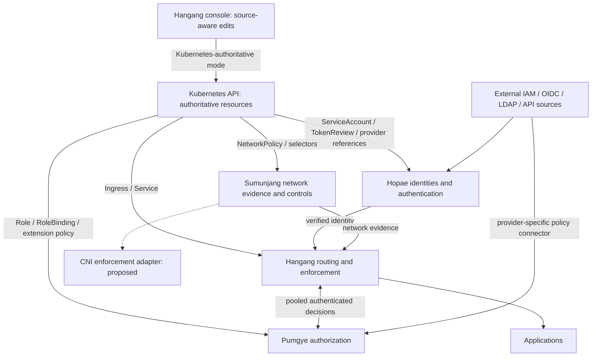

# ADR 0015: Kubernetes and IAM as authoritative sources

[한국어](../ko/0015-kubernetes-iam-authority.md)

Status: accepted direction with partial implementation. Hangang implements an
Ingress controller and offline import. Hopae verifies Pod-bound credentials with
TokenReview and live ServiceAccount/Pod UID checks. Pumgye implements an opt-in
Kubernetes-authoritative RBAC source with explicit application mappings and
bounded in-memory snapshots. These paths have an owned real-cluster qualification.
Sumunjang NetworkPolicy/selector sourcing, continuous watch recovery, source-aware
Kubernetes writes and complete four-component Kubernetes deployment remain open.
Internal production Pumgye currently uses its native database authority.

## Ownership and data flow

Kubernetes must be usable as the source of truth, not just a container scheduler.
Keep each adapter inside its owning component; keep Pumgye core independent of
Kubernetes clients. No direct etcd access or shared multi-writer business database.

| Component | Kubernetes source | Responsibility and limit |
| --- | --- | --- |
| Hangang | Ingress, Service; EndpointSlice integration to qualify separately | Existing routing controller; attach validated authorization references without silently publishing an unprotected route |
| Hopae | ServiceAccount, bound projected tokens, TokenReview; proposed authentication-provider references | Verify issuer/audience/expiry and bound object existence; names alone and Pod IP alone are not authentication |
| Pumgye | Role, ClusterRole, RoleBinding, ClusterRoleBinding; proposed application-policy CRDs | Preserve Kubernetes resource semantics and source provenance; application permissions require explicit mapping |
| Sumunjang | NetworkPolicy, namespace/Pod selectors and relevant endpoint facts; proposed network-risk CRDs | Preserve native network semantics; Hangang enforcement protects gateway traffic, CNI enforcement requires an actual supporting plugin |

Proposed CRDs are domain-owned extension resources, not implemented APIs. Establish
an API group/version and schemas in implementation before publishing manifests.
Provider configuration uses Secret references; no token/seed in CRD status, policy,
console output or logs. Kubernetes lacks native human User objects: authentication
comes from a verified provider, not RoleBinding subject creation.

## Source-of-truth modes

Select authority per cluster/tenant/domain: `database` (current native owner),
`kubernetes` (API objects authoritative), or `observe` (read-only comparison).
No last-writer-wins merging of DB and Kubernetes policies. In Kubernetes mode,
console writes target the owned resource with resourceVersion conflict protection;
DB is a recovery/materialization store, never an independent competing writer.
Show source, cluster identity, namespace, object UID, resourceVersion, generation,
digest, observedGeneration, applied revision, freshness, conflicts and validation
errors. GitOps-managed fields require GitOps-compatible editing or read-only UI.
Controller status records observed/applied state, never grants permissions.

List/watch adapters rebuild bounded candidates off the request path. Treat
resourceVersion as opaque, not an integer shared across clusters. Recover expired
watches through complete relists; never publish a partial list as authoritative.
Cross-object snapshots need a proven reconcile barrier or conservative refusal
while dependencies change; watches do not provide global atomic transactions.
Key facts by configured cluster identity plus object UID, namespace and subject.
Deletion, selector change, aggregate-role change and same-name recreation advance
local authority revisions and invalidate affected decisions.

Compile immutable indexes and atomically publish snapshots. Request processing
uses memory and pooled mTLS transports, not Kubernetes/cloud policy fetches.
Evidence caches remain 1–5 seconds maximum where permitted; authorization leases
are at most one second and bounded by every source deadline. Identity revocation
that requires TokenReview cannot be replaced by offline signature checks alone.
Expired or incomplete security authority fails closed for affected protected
traffic, including direct requests to a stale replica; readiness alone is not an
enforcement fence. Existing Hangang routing freshness behavior is not this new
security guarantee. Long streams require periodic source-revision enforcement.

## RBAC, IAM and enforcement semantics

Kubernetes RBAC is additive and has no deny rule. Preserve apiGroup, resource,
subresource, verb, resourceNames, nonResourceURLs, namespace versus cluster scope,
aggregation, wildcards and exact subject kind. Do not equate `get pods` with an
application's `read` permission without an explicit administrator-owned mapping.
Unknown scope or unsupported constructs refuse publication, never widen access.
`bind`, `escalate`, `impersonate` and service-account token issuance are privileged
capabilities and are not inherited into ordinary application roles.

Pumgye can impose additional gateway restrictions, but cannot claim those are
native Kubernetes RBAC denies. Direct API-server enforcement requires a separately
qualified authorizer/webhook and intentional authorizer ordering: an earlier allow
can bypass a later webhook. Admission webhooks are not read authorization. Close
alternate paths and qualify API-server access separately from Ingress application
access. Kubernetes RoleBindings do not create identities or cloud permissions.

NetworkPolicy is additive L3/L4 isolation, with ingress and egress considered at
both selected endpoints. Preserve selector namespace scope and policyTypes; do
not translate an arbitrary risk score into a native deny rule. Policy resources
require supporting CNI enforcement. DNS, NAT, hostNetwork and existing-connection
behavior require plugin-specific qualification; IP is network evidence, never a
substitute for a workload identity.

Cloud IAM connectors preserve provider-native decisions and policy provenance.
AWS explicit denies, resource-based grants, boundaries, session policies and
organization controls cannot be flattened into one generic role union or a
universal intersection formula. Hopae may broker scoped short-lived credentials;
Pumgye may further restrict the gateway, but cannot grant permissions the provider
refuses. Provider credentials stay native and do not become user headers. Follow
provider revocation/expiry and document unavoidable propagation windows.

## Deployment and qualification sequence

1. Fix integrated console discoverability; retain administrator checks.
2. Inventory existing Hangang Kubernetes behavior. Add four independent Deployments,
   Services, scoped ServiceAccounts/RBAC, probes, bounded resources, secret/certificate
   rotation and NetworkPolicies using only verified released images. Keep per-domain
   databases owned; replicas need qualified snapshot/backbone replication, not a
   shared SQLite mount. CNI and API discovery permissions remain explicit.
3. Implement read-only connectors and provenance/status UI, with no native grants
   changed. Define CRDs and explicit application mappings before write support.
4. Implement authoritative mode, owner-checked publication, conflict handling and
   follower fences; qualify revocation before protected deployment activation.
5. Test actual API-server/CNI integration in an isolated cluster: cross-namespace
   and cross-cluster confusion, issuer/audience mismatch, bound-object deletion,
   same-name recreation, role aggregation, impersonation/escalation, watch expiry,
   partial relist, rollback, stale replicas, controller outage, alternate access
   paths, secret rotation, draining and scale-out. Benchmark 10k and 100k queries/s
   on the complete enforcement chain; no claim from isolated core benchmarks.

No cluster resources or cloud IAM grants are changed by this ADR. The original
full-stack completion goal remains open.

## Primary references

- [Existing Hangang Kubernetes controller](https://github.com/ziozzang/hangang/blob/main/docs/KUBERNETES.md)
- [Kubernetes RBAC](https://kubernetes.io/docs/reference/access-authn-authz/rbac/)
- [Kubernetes authorization](https://kubernetes.io/docs/reference/access-authn-authz/authorization/)
- [Kubernetes service accounts](https://kubernetes.io/docs/concepts/security/service-accounts/)
- [Kubernetes NetworkPolicy](https://kubernetes.io/docs/concepts/services-networking/network-policies/)
- [AWS policy evaluation](https://docs.aws.amazon.com/IAM/latest/UserGuide/reference_policies_evaluation-logic.html)
- [AWS policy evaluation exceptions](https://docs.aws.amazon.com/IAM/latest/UserGuide/reference_policies_evaluation-logic_policy-eval-denyallow.html)

Implementation update: Pumgye `55cea05` adds bounded offline read-only RBAC inspection (`--inspect-kubernetes-rbac`, explicit cluster identity), preserving native rules/UID/opaque resourceVersion and refusing duplicate objects, unresolved or cross-namespace Role references and unsupported rules. Eleven workspace tests, strict clippy, real CLI no-state checks and owned mTLS HTTP/PPG1 publication/revocation/restart smoke pass. Live API watch, application mapping and source-authoritative publication remain pending; current production authority is unchanged.

Pumgye `1972ace` adds a separate live read-only HTTPS collector command. It pins the configured CA, refuses redirects/proxies, reloads bounded token/CA files, validates complete paginated collections, preserves per-kind opaque versions and swaps immutable diagnostic observations with a one-second freshness deadline. Failures remove the old view; the next cycle relists from the beginning. Owned HTTPS tests verify changes/deletion, pagination/scope/version failures, HTTP 410 recovery, credential rotation and no secret output/DB creation. Fourteen workspace tests, strict clippy and existing mTLS authority smoke pass; dependency audit reports only the existing allowed rustls-pemfile maintenance warning. This is polling, not scalable watch or application authority publication; no production cluster configuration is changed.

Pumgye `c4168da` adds explicit RBAC-to-application candidate mapping: exact cluster, pinned Role/Binding UID/scope, source subject and conjunctive literal resource/verb/name requirements. Each refresh rebuilds an empty-user template, so missing/recreated source objects remove candidate assignments; core compilation preserves required network/Guard constraints. The mapping digest is included and final live freshness is rechecked. Seventeen workspace tests, strict clippy, owned HTTPS mapped/deletion/recovery fixture, real offline CLI examples and existing mTLS authority smoke pass. Group/aggregation/privileged translation, API resource discovery, verified Hopae workload association and durable source-aware publication remain pending. Candidates are diagnostic and no production policies were changed.

Hopae `8aecbd5` implements a native Pod-bound TokenReview connector: fixed CA-pinned HTTPS API, separate reviewer credential, issuer/audience prechecks followed by trusted ServiceAccount UID/Pod UID/name attestation, Workload identity scoped by issuer/cluster and bound object IDs, service evidence capped at one second, bounded pooled requests and source circuit. Negative authentication diagnostics do not open the circuit; contradictory positive attestations do. Owned TLS mocks, final targeted tests/strict checks, documentation/scenario gates and a full regression run (907 passed, 42 ignored) pass; audit retains the scoped verification-only RSA exception and allowed rustls-pemfile warning. The mock does not prove actual cluster signatures/deletion behavior. Root profiles, HTTP/HOP1 dispatch, automatic reviewer/CA rotation, source deletion fencing, Pumgye association and receipt issuance remain pending. Kubernetes pending-deletion grace is not removed by a one-second local lease. No production connector is activated and released assets are unchanged.

Native integration update: Hopae `0a94fb0`/startup fix `c759137` connects reference-only TokenReview profiles to mixed explicit-prefix runtime routing, native owner publication, HTTP and HOP1, with workload/AAL-0 rendering and current human step-up refusal. Hangang `0b8e343`/docs `9291947` accepts canonical native workload AAL 0 only and preserves matrix/service/network/class gates plus credential stripping. Owned TLS HTTP/HOP1 tests verify routing isolation and in-flight profile retirement; optimized copied-owner tests verify workload HTTP/pooled mTLS and existing relay/Lua/MFA/TOTP Chromium flows. Full Hopae regression: 909 passed, 42 ignored; after the strict startup key-tree registration fix, config unit/preflight tests (24+18), strict checks and optimized candidate pass. Hangang identity tests (4), complete resource-policy suite (14), strict clippy and 892 documentation links pass. Existing scoped RSA exception and allowed rustls-pemfile warning remain.

Internal rollout: Hangang `0.3.2-workload-9291947`, Hopae `0.0.3-kubernetes-c759137`, schema v6, console package 0.1.6 (manifest SHA-256 `934fb613300b127df99f5b3ea7817d007877b5ff8c77bf710ae8a00ed855d4b4`). Configuration, keys and Pumgye policy were preserved; stopped owner/delegation DB backups, prior images and console registry remain available. Live API/matrix/native/SSO and actual profile/projection screen checks pass. Production profiles are native-only: no real Kubernetes/reviewer is configured; projection/receipt issuing RPC is inactive. Existing immutable release assets are unchanged. Actual cluster signatures/deletion semantics, mapped authorization publication, scalable watches, stream/follower fences and full-stack throughput remain open.

Actual Kubernetes qualification / live fence: Hopae `207396d` is tested against an owned loopback kind v1.37.0 API with real TokenRequest signatures. Native denial handling now accepts the actual negative response shape (omitted authenticated/audiences and user:{}), without opening the source circuit. TokenReview-only forced Pod deletion propagated in about 9.8 seconds; authenticated current Pod/ServiceAccount partial-metadata GET, UID/deletion checks and explicit namespace allowlists reduced observed withdrawal to 106–122 ms in the owned fixture. This is measured fixture behavior, not a fleet bound. Reviewer privileges are TokenReview create plus named object GET in the fixture namespace; RBAC object GET is not a metadata-only permission. Missing namespaces fail startup. Actual signature tampering, issuer/audience/unbound/refused reviewer, object deletion and same-name Pod recreation pass.

Full native regression: 911 passed, 42 ignored; owned TLS metadata/circuit checks, HTTP/HOP1 retirement, strict checks and optimized copied-owner workload/mTLS/relay/Lua/MFA/TOTP Chromium qualification pass. The existing scoped RSA exception and rustls-pemfile warning remain. Internal Hopae image `0.0.3-kubernetes-207396d` and console 0.1.7 (manifest `d620fb19edc574e08341a32a01e1c36c3dfedb709573c4dd32889ad02f5eb578`) are active; configuration/keys/native-only production profiles and Pumgye policy are preserved, with stopped v6 backups and previous images/registry. Live API/matrix/native/SSO/profile screens pass. The isolated test cluster is separate from production and its fixture namespaces/RBAC are removed. Production Kubernetes is unconfigured. Watch-based object indexing, other versions/topologies, follower/stream revocation, mapped automatic publication and full-stack performance remain open; tagged release assets are unchanged.

Pumgye `ec2fe0f` is qualified against the owned v1.37.0 API for read-only RBAC collection and explicit mapping candidates. Real typed lists omit item kind/apiVersion, unlike combined kubectl output; normalization now supplies missing types only from the validated collection and refuses explicit conflicts. Actual Binding deletion removes candidate assignments, same-name recreation fails the old UID pin, and credential failure fences observations until recovery. Eighteen workspace tests, strict clippy, owned HTTPS/mapping and existing mTLS authority regression pass. The fixture uses a fictional native subject reference and never creates an authority DB or changes production policy; it does not prove Hopae association or automatic publication.

Pumgye `f78dda7` implements opt-in sole-writer Kubernetes policy reconciliation using explicit administrator associations. Policy/revision/audit commit before immutable publication; source eligibility is withdrawn before collection and expires at the original one-second observation deadline. A persistent ownership marker rejects native-writer downgrade, startup does not authorize from cached grants, and administrator policy PUT returns 409. Actual owned v1.37.0 API tests verify mTLS HTTP/pooled PPG1 allow/deny parity, durable Binding-deletion revision, recreated UID refusal, credential recovery, writer exclusion and restart fences. Nineteen workspace tests, strict clippy and observation/native transport regressions pass. Hangang `80bdfb4` makes source-owned policies inspectable but read-only; four browser tests pass. This polling mode has collection-time unavailable intervals and is not distributed watch or automatic Hopae identity association; production source mode remains disabled.

## UID-pinned Hopae / Pumgye workload association — 2026-10-14

Pumgye `9f203e5` accepts a workload descriptor instead of an opaque native subject
reference: exact issuer, mapping cluster, namespace, ServiceAccount name/UID and
Pod name/UID derive Hopae's canonical Workload subject. The RBAC ServiceAccount
name/namespace must agree, and conflicting native-reference/workload forms fail.
Identity hashing remains compile-time work; network/Guard/application constraints
are preserved. This computes an address, not authenticated evidence. Hopae owns
TokenReview, issuer/audience and live-object UID/deletion verification.

The owned real Kubernetes v1.37.0 fixture uses actual signed Pod-bound credentials
and the native Hopae connector. Its verified subject matches the Pumgye mapping
and receives the mapped role over mTLS HTTP/pooled PPG1. A different actually
verified Pod of the same ServiceAccount remains guest. Pod deletion invalidates
the original credential; Binding deletion/recreation, source credential recovery,
writer exclusion and restart fences also pass. Pumgye workspace 20 tests, strict
clippy, fictional offline example and observer mapping regression pass. Hopae
`b20ffee` pins the same reserved-example interoperability vector in its native
attestation test, which passes.

This is administrator-pinned UID association, not automatic Pod discovery or UID
repinning. Authentication still must arrive through Hangang's trusted native path;
this fixture does not qualify the full gateway request/stream pipeline. Existing
production configuration, component images and release tags are unchanged. Watch
reconciliation, full-chain qualification, followers, remaining identity providers,
Kubernetes deployment and public-release gates remain part of the active goal.

## Four native runtime Kubernetes request chain — 2026-10-14

Pumgye `c52e9e1` adds maintained four-process qualification to the owned real
Kubernetes workload/RBAC fixture. Actual Hangang/Hopae/Pumgye/Sumunjang processes
use fresh isolated state/keys, public HTTPS and native mTLS HOP1/PPG1/HGD1.
The application port matches the actual TLS listener; older gateway binaries
without native TLS capability are refused. No protocol impersonator replaces a
component in this mode.

The actual signed Pod credential reaches the backend only after native Hopae
verification, enforced Sumunjang evidence and the UID-mapped Pumgye permission.
The backend sees the canonical subject, Workload kind, matching service and AAL
zero; forged client identity/AAL headers do not survive, and Authorization is
consumed. Another valid Pod, absent authentication, observe evidence, explicit IP
block and deleted Binding all prevent backend dispatch; block removal recovers.
Source credential failure causes gateway 503, and Pod deletion causes 401. The
actual delegated status exposes Kubernetes ownership and delegated publication
with both correct revision fences still rejects source-policy overwrite.

The fixture passes against the owned v1.37.0 API, including existing native
association, source recovery/recreation and restart checks, and removes its
unique RBAC/namespace and processes. Production configuration/images are
unchanged. This is real request-chain qualification, not Kubernetes Pod packaging,
Ingress ownership, streaming credential revocation, CNI-wide enforcement,
distributed watches/followers or full-chain throughput. Conservative polling
availability intervals and all remaining original goal gates remain open.

## Bounded native machine evidence leases — 2026-10-14

Hopae `0cd46ba` exports remaining verified service/workload evidence lifetime over
HTTP/HOP1 as `x-hopae-evidence-ttl-ms`, capped at 1000 ms; expired evidence produces
503 without identity. Hangang `ce08314` anchors the lifetime before the native
exchange, refuses invalid/duplicate/exhausted TTL and attaches expiry to shared
route retirement, response/upload bodies and upgrades. Legacy trusted peers
without TTL receive a local one-second cap. The 250 ms retirement polling interval
is explicit; this is not an exact one-second wire-time guarantee or a cached allow.

An isolated idle-stream test holds policy and origin unchanged and verifies
retirement within 1.5 seconds. Fifteen resource-policy tests, TTL adversarial unit,
strict clippy and 892 documentation links pass. The concurrent upstream Ingress
Host-preservation change was reviewed and integrated without changing Actions
activation; its test and the resource-policy tests pass after rebase. Hopae native
library lifetime assertions, actual HTTP/HOP1 retirement scenario, strict clippy
and EN/KO documentation checks pass. Optimized binaries qualify against the real
owned v1.37.0 API/four native processes: explicit TTL is present over HTTP and
mTLS HOP1, a machine stream closes within the evidence/source bound, and previous
request/credential/revocation checks still pass. Pumgye `f45f38b` maintains that
qualification. The actual source fixture can retire a stream via source freshness
as well; the isolated unchanged-policy test proves the native expiry path.

This conservative first lease implementation ends machine operations/streams
lasting beyond the short evidence lifetime. Authenticated renewal and targeted
Hopae credential-revocation subscription remain necessary for sustained valid
long-lived streams. Production images were not switched in this phase; policy,
keys and release tags remain unchanged. Distributed watches/followers, full
Kubernetes packaging, remaining providers/lifecycle, full-chain performance and
public release/operational completion gates remain active.

## Opt-in native machine evidence renewal — 2026-10-14

Hangang `058fe3f` adds `auth.renew_native_evidence` for native service/workload
operations. The same bounded authenticated pool re-verifies original request
context around half-life; explicit usable TTL and exact unchanged subject/kind/
AAL/service are required. Denial, outage, exhausted capacity, malformed/short proof,
changed identity or previous expiry permanently retires the lease. Late evidence
cannot revive it. The original selected authentication headers remain private in
memory until close; last-owner drop aborts the task and discards context. There
are at most 4096 renewal leases per process, plus existing native pool limits.
Default behavior remains non-renewing expiry; renewal requires a native transport.

Seventeen resource-policy tests and OpenAPI reference validation pass. The owned
native peer sustains streams beyond two seconds, then verifies closure for denial,
outage, identity replacement and short expiry with unchanged policy/origin.
Strict all-target clippy passes. The optimized binary passes the actual four-native-
component/Kubernetes default-mode regression. Incoming upstream changes were
reviewed and rebased; they add Ingress documentation/examples/changelog rather
than altering renewal implementation. Documentation links after rebase: 916 pass.

This qualifies the gateway renewal mechanism against an owned native peer; it
still needs sustained real Hopae/Kubernetes renewal qualification, cancellation/
quota saturation measurements, targeted revocation subscription and fleet-scale
throughput. Kubernetes RBAC polling can independently withdraw source health and
retire a valid stream, so watch/follower continuity remains necessary. Production
images/configuration and release tags were not changed by this phase. The original
full completion goal remains active.

## Renewal cancellation, quota and irreversible expiry — 2026-10-14

Hangang `d963b8d` applies the remaining-lifetime minimum to renewal replies as well
as initial admission, and marks retained authentication context sensitive for
formatting. The owned transport test exhausts all 4096 renewal permits, confirms
new admission fails, then verifies that last-owner drop cancels an actual in-flight
native socket and returns every permit. Missing renewal response times out without
extending the lease; once expiry is observed, setting a later deadline cannot
revive it. The resource-policy short/expired-TTL scenarios now keep identity
unchanged so identity mismatch cannot mask lifetime rejection.

The lifecycle transport unit, 17 resource-policy tests, strict all-target clippy
and 916 documentation links pass. This is bounded lifecycle/transport qualification,
not a fleet throughput or sustained real-cluster renewal claim. Production images,
configuration and release tags were not changed. Actual source continuity/watch,
long-lived real provider qualification, rollout, remaining lifecycle/provider
features, distributed followers and full performance/release gates remain active.

## Actual native workload stream renewal — 2026-10-14

Pumgye `fb53091` maintains `--qualify-renewal` in the actual four-component owned
Kubernetes fixture. Normal source-authoritative RBAC deletion/recreation, failure
and restart checks remain. A separate native Pumgye DB holds the previously
verified candidate fixed to isolate credential renewal from polling health
withdrawal. This is an explicitly named test isolation, not production fallback
or Kubernetes RBAC watch-continuity qualification.

Actual Hangang/Hopae/Sumunjang/Pumgye processes and real signed Pod-bound
credentials sustain heartbeat streaming beyond 2.2 seconds with native evidence
renewal enabled. Actual Pod deletion closes the stream within the fixture's
1.5-second post-delete deadline and subsequent authentication returns 401.
Canonical identity/kind/service/AAL and absence of backend Authorization remain
verified. The upgraded optimized gateway and the owned v1.37.0 API pass the
complete fixture; owned processes/resources are cleaned up and production state
is unchanged. This proves actual provider-backed renewal and credential withdrawal
under fixed authorization, not dynamic RBAC continuity or fleet performance.

Source watch/follower continuity, failure topology, complete Kubernetes packaging,
remaining mixed-provider/lifecycle features, full performance, release and rollout
gates remain active under the original objective.

## Source collection age consumes freshness — 2026-10-14

Pumgye `ecf4544` changes the source observation lease to expire one second after
collection starts. Previously a slow multi-list collection could receive another
second at completion. The whole collection now times out after one second, and
post-normalization/hash age and clock overflow are checked before publishing.
Mapping/compilation/durable installation continue to consume that original budget.
No stale or partial observation becomes a usable grant.

Twenty-one workspace tests and strict clippy pass. The owned HTTPS fixture delays
a complete response for 1.2 seconds, verifies unavailable and subsequent recovery;
the deadline arithmetic test verifies elapsed time cannot restart freshness.
The actual v1.37.0/four-native-component fixture, including isolated real workload
renewal and Pod deletion withdrawal, passes with the tightened source budget.
Production configuration/images and release tags remain unchanged.

This fixes source-age inflation; it does not claim cross-kind atomicity or watch
continuity. Slow/large sources exceeding the budget are unavailable rather than
silently receiving extended authority. Scalable watches/followers, deployment,
remaining provider/lifecycle functions and full performance/release completion
remain required by the original active goal.

## Persistent pinned source connections — 2026-10-14

Pumgye `508bb73` reuses the Kubernetes HTTPS client across cycles with unchanged
actual CA/token material. Bounded files are still read/validated each cycle and
authorization is freshly constructed; changed trust/credential material retires
its previous pool. Configured roots, no proxy/redirect, one-second source-start
freshness and failure fencing remain. At most two idle connections per origin
and ten-second idle expiry apply to transport, not cached authorization.

The owned HTTP/1.1 TLS fixture counts one accepted connection across two complete
unchanged paginated cycles, and replacement connections for credential change/
recovery. CA error/recovery, source changes/deletion, redirect/410, slow collection,
proxy isolation and privacy checks pass. Workspace 21 tests and strict clippy
pass; the actual v1.37.0/four-native-process and isolated renewal fixture passes.
This proves connection reuse/rotation behavior, not a full-chain QPS result.
Production images/configuration and release tags are unchanged. Scalable watches,
follower continuity, deployment, remaining mixed-provider lifecycle and complete
performance/release gates remain part of the original active goal.

## Internal Pumgye runtime rollout — 2026-10-14

The optimized Pumgye server built from `508bb73` is deployed internally. Its
previous executable and stopped SQLite backup are retained for rollback. Existing
native policy mode, policy document/revision, gateway configuration and mTLS
listener settings are preserved. The source-owner metadata schema initializes
without changing the committed business policy; authenticated status now reports
native ownership.

The release executable passes independent mTLS HTTP/PPG1 trust/token isolation,
bounded pipelining, revision floors, CAS races, immediate policy revocation,
exclusive DB ownership, audit and restart recovery. Post-rollout read-only actual
HTTPS API proof verifies scoped service authentication, method/guest/spoof denial
and no upstream credential. Actual unified menus/matrix/logout and deployed native
Guard transport pass. The service is active; policy and gateway configuration
match the captured baseline after qualification.

This operational rollout does not activate Kubernetes source authority or change
Hopae/Hangang/Sumunjang production images. Public release tags are unchanged.
The remaining watch/follower continuity, mixed-provider lifecycle, fleet throughput,
Kubernetes packaging and complete release/rollout gates stay in the active goal.

## Internal Hopae evidence-lifetime rollout — 2026-10-14

Hopae `48c8015` moves the machine lifetime wire assertions into the gateway domain
so the full boundary gate passes. A pre-existing saturation timing failure (133
rather than 136 overload responses) passed in isolation; the test's hold window
was widened without reducing its rejection threshold, and full rerun passes.
Full native gates: 912 passed, 42 ignored; strict check/boundary, documentation and
scenario coverage pass. Dependency audit retains the existing scoped verification-
only RSA exception and rustls-pemfile maintenance warning, not an unrestricted
clean audit claim.

The optimized copied-state candidate passes Kubernetes workload HTTP/pooled mTLS,
prefix isolation, external relay/Lua, browser external MFA/TOTP coexistence and
old-handle refusal. Internal image `hopae:0.0.3-evidence-48c8015` is deployed with
consistent stopped v6 owner/delegation DB backups and the previous image retained.
Configuration files, authentication profiles and key material are preserved.
Actual API/matrix/module/SSO/native regressions pass; direct deployed verification
returns bounded remaining evidence TTL with service identity/AAL zero.

Production remains native-profile-only: Kubernetes/external verifier/projection
activation was not enabled. Hangang renewal rollout remains a separate step.
Public release tags and broader provider/lifecycle, watch/follower continuity,
Kubernetes packaging and full-chain performance/completion gates remain unchanged
and active under the original goal.

## Internal Hangang evidence/renewal rollout — 2026-10-14

Gateway image `hangang/gateway:0.3.2-renewal-d963b8d` is internally deployed from
the qualified optimized binary. Previous image/compose/configuration/policy
backups are retained. Existing console binary is preserved. The gateway swap
first preserves the full configuration and Pumgye policy; actual API permissions,
credential stripping, matrix/modules/native Guard and SSO/logout regressions pass.
Resource-policy 17 tests, native TTL unit and Ingress Host regression pass before
rollout.

A separate revision-fenced publication enables `auth.renew_native_evidence` on
exactly two existing protected native service-probe routes. The post-publication
comparison proves every other configuration field and the Pumgye policy remain
unchanged. Actual scoped API, guest/spoof/method denial, modules and SSO pass again.
This is an internal limited canary, not blanket activation for every service or
a sustained production stream-load qualification. The current upgraded Hopae
exports explicit bounded TTL required by renewal.

Kubernetes source/watch continuity, broad distributed deployment/membership,
remaining identity-provider lifecycle, full-chain throughput and final public
release/completion gates remain active. This phase does not create new release
tags or enable GitHub Actions.

## Live internal renewal stream proof — 2026-10-14

A temporary controlled stream origin and route verify the currently deployed
Hangang/Hopae/Pumgye canary. Heartbeats continue beyond 3.2 seconds with evidence
renewal enabled; client closure releases the origin, authenticated subject/AAL
remain correct, and the bearer credential is absent upstream. Pumgye policy is
unchanged. The temporary route is removed and existing protected configuration
restored through revision-fenced publications; actual scoped API proof passes
again after cleanup. Only monotonic configuration revisions advance.

Initial attempts exposed fixture setup mistakes, not a proven renewal failure:
appending a narrow path behind the existing prefix route reached the old origin,
and removing an enforced scope was correctly refused. A distinct resource ID
inside the established namespace was also correctly refused. Shared resource IDs
are intentional when policies/authenticators match; they must be disabled and
restored consistently across the shared scopes. Corrected prefix order and shared
policy transition make the live proof pass. No validation rule was weakened and
no erroneous duplicate-ID rejection was added.

This is a short live functional/cancellation canary proof, not sustained load,
credential-revocation fleet qualification or full-chain QPS measurement. The
broader original watch/follower, provider lifecycle, Kubernetes packaging,
performance and final release/completion gates remain active.

## Single-decision native transport performance — 2026-10-14

Pumgye `0409a7a` maintains parameterized native benchmarking and varying lookup
cardinality. With batch one, 16 persistent mTLS connections and three ten-second
closed-loop trials on an 8-core/16-thread Ryzen 7 8745HS, the small hot policy
measures 138,790–142,300 verified decisions/s (p99 177–182 microseconds). Varying
4096 users and /32 prefixes plus one base conformance entry measures
129,080–134,344 decisions/s (p50 115–119, p99 183–195 microseconds). Every reply's
allow, correlation and revision floor is checked. The same generator binary is
used for both published workloads; hashes/raw counters/reproduction are committed.

Batch-64 compatibility, native trust/token rejection, CAS, immediate revocation,
audit/restart, 21 workspace tests and strict clippy pass. The fixture has one
service/role/permission, two classes and synthetic assurance/Guard evidence.
Server and generator are separate processes over loopback; no operational service
receives this load. This proves Pumgye component headroom above 100k/s under these
conditions, not the whole Hangang/Hopae/Sumunjang chain. Arrival-rate saturation,
provider/network costs, denial mix, fleet distribution and full-chain tail/load
acceptance remain open. Production deployments/policies and release tags are
unchanged by this benchmark phase; the original completion goal stays active.

## Actual four-component request-chain load — 2026-10-14

Pumgye `60a69b0` maintains an owned real Hangang/Hopae/Pumgye/Sumunjang benchmark:
public HTTPS, native API-key authentication, enforce-mode network authority,
identity/IP/permission intersection and internal pooled mTLS HOP1/PPG1/HGD1. A Go
origin verifies canonical service/kind/AAL and absence of Authorization; every
successful load reply is 200 with exact body. No authentication protocol peer is
mocked and no operational service receives the load.

Three ten-second closed-loop trials with 16 workers measure 11,081–11,657 verified
responses/s, p50 1,339–1,422 us, p99 2,041–2,091 us, zero failed replies. At 32
workers, 10,365–10,914/s and p99 4,238–5,642 us show no benefit from more concurrency.
A preliminary Python-origin fixture gives 7,791–8,214/s; the fast validated origin
removes some fixture cost. This qualifies a controlled lower 10k/s chain target,
not 100k/s. Pumgye's component throughput is not substituted for chain capacity.
Raw counters/hash/provenance, reproduction, workload and limitations are committed.

The fixture checks guest/invalid credentials, observe evidence and explicit IP
block denial before load. Go build/vet, Python validation and the modified
fixture's actual Kubernetes/four-process/real renewal withdrawal regression pass.
There is one warm service/key/role and tiny body over loopback with no external
issuer/TokenReview load. Open-loop arrival overload, denied mix, long renewal
load, physical/fleet topology and 100k/s optimization remain required, alongside
watch/follower, provider lifecycle, Kubernetes packaging and final release gates.
Production images/policies/configuration are unchanged by this benchmark phase.

## Request-local authenticated network evidence reuse — 2026-10-14

Hangang `d3742b8` removes redundant admission/authorization Guard RPC when the
same request already holds current authenticated network evidence. Proof binds
the actual Guard instance, canonical IP, observed revision and at most one second
from its original query start. Changed binding or expiry re-queries; snapshot,
fail-open and optional cache hits cannot issue reusable proof. Each new request
still performs normal admission; no cross-request decision cache is added. This
uses a still-valid issued proof, not instantaneous remote-change notification.

Authority/IP/revision/deadline adversarial test, 19 matching Guard-related tests,
17 resource-policy tests, strict clippy and documentation checks pass. Actual
Kubernetes/four-process/real renewal and Pod-deletion regression passes. The same
16-worker closed-loop chain gives 11,764–12,492 verified replies/s, p99
1,862–2,110 us, zero failures; raw source/hash/counters are recorded in Pumgye
`7cc84c1`. Prior observed range was 11,081–11,657/s; measurements are not a
promised gain and do not achieve the full 100k/s target.

Production gateway image was not switched by this optimization phase. Further
profiling, open-loop/fleet/provider load, watch/follower continuity, remaining
provider lifecycle and final deployment/release gates remain active.
