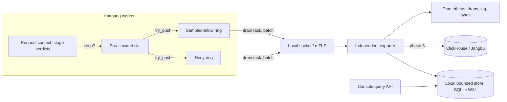

# ADR 0019: Decision event schema and bounded exporter

[한국어](../ko/0019-decision-events-exporter.md)

Status: **Accepted as architecture — 2026-10-18**. It refines the
[observability design](../OBSERVABILITY.md) and ADR 0004 for one event class, the
per-request access decision, and is the data prerequisite for the console redesign
in [ADR 0020](0020-unified-console-redesign.md).

> Acceptance record (owner-directed resumption, 2026-10-18): adopt the stated
> ownership and bounded/fail-closed design. Implementation exists in varying
> unmerged review units; acceptance is not completion, release, deployment,
> retention-policy activation or a conformance claim. Context below is the
> historical design baseline. Open questions and phased acceptance gates remain
> explicit backlog; see [current roadmap](../ENTERPRISE_ROADMAP_2026-10-18.md).

## Context

Hangang already enforces a multi-authority decision on each protected request:
Sumunjang (Guard) network evidence over HGD1/gRPC, Hopae identity verification over
HOP1/gRPC, Pumgye authorization over PPG1/gRPC (including observed permits), and
Hangang's own route resolution, obligations and final owner/revision fences. Each
authority keeps component-local records (Sumunjang threat candidates and blocks,
Hopae authentication events, Pumgye publication audit, host plugin journal), but
**no record ties the stages of one request together**. The design deliberately
retains no request logs, and the exporter in OBSERVABILITY.md is still proposed.

Consequently the console cannot answer the first questions an operator asks of a
commercial zero-trust product (Cloudflare Zero Trust access logs, Okta System Log,
Teleport audit, Tailscale ACL tests): *who was refused, where, by which authority,
under which rule and revision, and what would happen if I changed this policy?*
A review of the console found no cross-component decision log, no request detail,
and no what-if simulator, and no data from which to build them.

## Decision

1. Hangang emits **one decision event per enforced protected request** that is
   retained by the sampling rules below, and one per admin **simulation** (flagged).
   Hangang is the only emitter for gateway traffic because it is the single point
   that observes every stage and the final enforcement result. Authorities do not
   emit duplicate per-request copies of the same decision.
2. The event carries an **ordered per-stage verdict list** plus a **revision vector**
   of every authority consulted. It never carries headers, bodies, query strings,
   cookies, credentials, receipts, permits or provider tokens.
3. Subjects and client IPs are **pseudonymized with rotating keyed HMAC**. Bounded
   sealed copies exist only under the `standard` privacy profile, are decryptable
   only while the epoch key exists, and are revealed only by audited privileged
   console operations.
4. Emission is a non-blocking `try_push` into a **bounded in-memory ring**; an
   **independent exporter** drains it. Drops are counted, never waited on. The
   request critical path performs no I/O, no allocation beyond a preallocated slot
   and no analytics call.
5. The first sink is a **local bounded store** owned by the exporter (SQLite in WAL
   mode with byte/age caps) that serves the console query API. ClickHouse or Jangbu
   are later sinks behind the same exporter; none of them is a policy authority.
6. Simulation (explain/what-if) does **not** read the event store for its verdicts.
   It dry-runs each authority's own admin explain API against current or candidate
   state. The event store only supplies historical traffic for impact estimates.

## Event schema (`hangang.decision.v1`)

The wire format is a versioned protobuf message
(`hangang.decision.v1.DecisionEvent`) in length-delimited batches; the JSON shown is
the console API projection. Unknown enum values decode as `unspecified` and are
displayed as unknown, never as allow. Encoded events are capped at 2 KiB; every list
has a fixed maximum and a `truncated` flag.

```json
{
  "schema": "hangang.decision.v1",
  "event_id": "01JA9Q4Z8M3V7T2C6R1K5N0PXE",
  "kind": "enforced",
  "request_id": "hg-7f3a9c2e41d08b65",
  "time": "2026-10-16T09:12:44.512Z",
  "emitter": {"component": "hangang", "instance": "gw-a", "build": "0.3.12"},
  "route": {"listener": "https-443", "host": "app.example.test", "route_id": "app-api",
            "path_template": "/api/reports/{id}", "method": "GET",
            "service": "reports", "resource": "report", "action": "read"},
  "outcome": {"result": "deny", "status": 403, "deciding_stage": "authorization",
              "reason": "pumgye.class_denied"},
  "stages": [
    {"stage": "network", "authority": "sumunjang", "verdict": "allow", "mode": "enforce",
     "rules": ["asn-allow-corp"], "revision": 418, "latency_us": 41,
     "transport": "hgd1", "client": {"ip_ref": "ip~4MZQ7K2V9B", "prefix_ref": "pfx~Q1W8",
     "asn": 64500, "country": "KR"}},
    {"stage": "identity", "authority": "hopae", "verdict": "authenticated",
     "subject_ref": "sub~7HC2LQ0D5E", "principal": "human", "provider": "oidc-corp",
     "aal": 1, "factors": ["federated"], "session_ref": "ses~K93TT0",
     "generation": 5521, "latency_us": 183, "transport": "hop1"},
    {"stage": "authorization", "authority": "pumgye", "decision": "ClassDenied",
     "roles": ["analyst"], "information_class": "restricted", "required_aal": 2,
     "revision": 77, "permit": null, "latency_us": 22, "transport": "ppg1"},
    {"stage": "enforcement", "authority": "hangang", "action": "refused",
     "obligations": [], "fence": "ok", "revision": 268}
  ],
  "revisions": {"hangang": 268, "sumunjang": 418, "hopae": 5521, "pumgye": 77,
                "catalog": 12},
  "sampling": {"class": "deny", "rate": 1.0},
  "privacy": {"profile": "standard", "key_epoch": "2026-10-16"}
}
```

### Common fields

| Field | Meaning |
| --- | --- |
| `event_id` | 128-bit sortable ID generated by the emitter; deduplication key for at-least-once delivery |
| `kind` | `enforced`, `simulation` (admin dry-run, never enforced) or `shadow` (candidate evaluation alongside live traffic, never enforced) |
| `request_id` | Hangang request ID. Deny/challenge pages may show it as a support reference (see ADR 0020) |
| `time` | Emitter wall-clock admission time. Stage order and latency use Hangang's monotonic clock; per ADR 0018, authority clocks are not compared with it |
| `route` | Route/listener/host identity and the **path template**, never the raw path or query; service/resource/action as resolved by Hangang/catalog |
| `outcome` | Final result `allow`, `deny`, `challenge`, `error` or `unavailable`, HTTP status, the deciding stage and a stable namespaced reason code |
| `revisions` | Revision vector: Hangang configuration revision, Sumunjang policy revision, Hopae state generation, Pumgye policy revision, catalog bundle revision. Absent authority = not consulted, not zero |

### Stage verdicts

Stages appear in evaluation order. A stage that was not reached is omitted and the
deciding stage explains why; concurrently queried stages record their own latency.

| Stage | Authority | Fields |
| --- | --- | --- |
| `network` | Sumunjang | `verdict` (`allow`, `deny`, `observe`, `unavailable`, mirroring Pumgye `GuardEvidence`), `mode` (`observe`/`enforce`), matched rule/block IDs (≤8), policy revision, pseudonymous IP and prefix references, ASN, country |
| `identity` | Hopae | `verdict` (`authenticated`, `anonymous`, `challenge`, `denied`, `unavailable`), pseudonymous subject and session references, principal kind (`human`, `service`, `workload`), provider ID, AAL, factor enums (≤6), state generation |
| `authorization` | Pumgye | `decision` as the exact `pumgye_core::Decision` variant: `Allow`, `UnknownService`, `Guest`, `NetworkGuest`, `PermissionDenied`, `ClassDenied`, `AssuranceDenied`, `GuardDenied`, `GuardUnavailable`; matched roles (≤8), information class, required AAL, policy revision, observed-permit digest prefix when issued |
| `enforcement` | Hangang | `refused`, `challenged`, `forwarded` or `redirected`; obligations applied (for example a credential projection contract per ADR 0014, ≤8); final fence result (`ok`, `stale_owner`, `revision_regressed`, `expired`); upstream status class when forwarded |

Reason codes are namespaced (`sumunjang.*`, `hopae.*`, `pumgye.*`, `hangang.*`) and
registered with en/ko message keys (ADR 0020). Adding a Pumgye `Decision` variant or
a reason code requires a schema minor version, a message key and a contract test.

## Privacy

The original requirement "do not retain request logs" stands for **traffic**: no
access log, no URLs with parameters, no headers or bodies. This ADR adds a bounded,
pseudonymized, configurable and disable-able record of **access decisions**. That
is the minimum data needed to explain an enforcement outcome to an operator.

- **Pseudonyms.** `ip_ref`, `prefix_ref` (/24 IPv4, /48 IPv6), `subject_ref` and
  `session_ref` are `HMAC-SHA-256(epoch_key, domain || value)` truncated to 80 bits,
  base32 with a type prefix. Domain separation prevents cross-type joins.
- **Key epochs.** Default rotation 24 h (configurable 1 h–30 d). Keys are a secret
  reference shared by all Hangang replicas of one deployment so pseudonyms correlate
  across nodes. A key is destroyed when the last event of its epoch expires; after
  that, the epoch's pseudonyms are unlinkable to people (crypto-shredding).
- **Sealed fields (profile `standard`, the default).** The event additionally
  carries the Hopae opaque subject ID and client IP sealed with AEAD under the epoch
  key. They are never exported to ClickHouse/Jangbu by default. Console roles with
  `decisions:reveal` see resolved identities; each list/detail response that
  unsealed values writes one audit record (actor, query digest, count). IP reveal
  is a separate `network:reveal-ip` permission.
- **Profile `strict`.** No sealed fields. Forward lookup only: from a user detail
  page the query service computes the user's pseudonyms for retained epochs and
  searches by them; reverse resolution is impossible by design.
- **Profile `off`.** No decision events; the console shows the decision log as
  *disabled* (not *empty*) and simulation still works because it uses live explain.
- **Retention.** Local store default 7 days and 2 GiB, whichever is reached first;
  hard maximum 90 days. Retention per sink is independent and documented.
- **Excluded always.** Headers, cookies, bodies, query strings, raw paths, receipts,
  permits, session tokens, provider tokens, email, display names, Lua source.
- Metrics remain low-cardinality per OBSERVABILITY.md: no pseudonym in a label.

## Sampling

Head sampling is deterministic on `request_id` so every replica and stage agree.

| Class | Default | Rule |
| --- | --- | --- |
| Deny, challenge, error, unavailable | 100% | Subject to a per-(route, `prefix_ref`) token bucket; excess becomes one `suppressed` summary event per bucket window carrying the count and first/last time |
| Allow | 1% | Configurable per route 0–100%; `audit_all` routes (for example admin APIs, `restricted` class) default to 100% |
| Trace | 100% for a target | Time-boxed (≤60 min) operator trace of one user, route or prefix; creating it requires `decisions:trace`, a reason and is audited |
| Simulation/shadow | 100% | Stored in a separate partition; excluded from traffic counts |

Allow counts in the console are labelled as **estimates** derived from sample rate;
exact request counts come from Prometheus counters, which remain authoritative.

## Transport and exporter



- Stage verdicts are already present in the request context; recording them costs a
  few fixed-size writes. The event is materialized only when kept.
- Each worker owns two bounded rings (default 8,192 deny and 4,096 allow slots), so
  an allow flood cannot evict denies and a deny flood is bounded by the token bucket.
  A full ring increments `hangang_decision_events_dropped_total{class}`.
- A drain task batches up to 512 events or 250 ms and sends them to the exporter over
  a local Unix socket or mTLS. If the exporter is down, rings fill and drop; Hangang
  has **no disk spool** and never retries on the request thread.
- The exporter is a separate process (ADR 0004) with bounded ingest, its own store
  credentials and **no policy mutation credential**. It writes the local store with
  `event_id` uniqueness (at-least-once safe) and enforces age/byte caps by dropping
  whole partitions. Later sinks use acknowledged inserts as in OBSERVABILITY.md.
- Component-local events stay where they are owned (Hopae authentication events,
  Sumunjang candidates, Pumgye audit, host plugin journal). Decision events reference
  them by ID where useful; the console federates them rather than copying them into
  a shared multi-writer schema. Decisions not passing through Hangang (Kubernetes
  TokenReview/SubjectAccessReview per ADR 0015/0016) are emitted by the deciding
  authority with the same schema and `emitter.component` set accordingly (phase 3).

Performance budget: at 100k decisions/s with 1% allow sampling, total CPU overhead of
event capture plus draining stays at or below 2% and adds no measurable p99 latency
(≤5 µs) versus `off`. These are qualification targets, not claims.

## Console APIs enabled

Served by the exporter's read-only query service through the Hangang host broker,
authorized per console permission, all bounded (≤200 rows/page, ≤31-day window,
deadline 3 s, cursor pagination):

| API | Purpose |
| --- | --- |
| `GET /v1/observability/decisions` | Server-side filtered, sorted, paginated decision log: time, outcome, deciding stage, reason, route, service, resource, class, subject, IP/prefix, ASN, country, principal kind, revision |
| `GET /v1/observability/decisions/facets` and `/timeseries` | Counts by outcome/reason/route/stage for overview tiles and charts |
| `GET /v1/observability/requests/{request_id}` | Request detail: all events for one request (including retries) in stage order |
| `POST /v1/observability/reveal` | Explicit audited unsealing for a bounded set of event IDs |
| `POST /v1/explain` | Hangang-orchestrated simulation (below) |
| `POST /v1/observability/impact` | Re-evaluate retained historical contexts against a candidate policy |

**Explain/simulate.** Input: host/method/path or service/resource/action, subject
(Hopae user ID or anonymous), principal kind, optional hypothetical AAL/factors,
client IP and time. Hangang resolves the route against current or candidate
configuration, then calls each authority's admin explain endpoint concurrently:

- Sumunjang: existing `lookup`/`networks/inspect`, extended to accept a candidate
  policy document reference.
- Hopae: new `POST /v1/admin/explain/authentication` returning the subject's status,
  providers, profile and achievable AAL; no session is created or touched.
- Pumgye: new `POST /v1/explain` returning the `Decision` variant, matched and
  missing roles/assignments, class and AAL requirements and revision, for the
  published or a candidate policy. It issues no permit and writes nothing.

Each response is labelled with the evaluated revision. The result is stored as a
`simulation` event and audited. Simulation is rate-limited per actor and cannot
produce credentials, permits, sessions or policy changes.

**Impact (what-if).** For a candidate Pumgye or Sumunjang policy, the query service
streams retained contexts (deduplicated by subject/route/class) from the selected
window to the authority's batch explain and reports changed outcomes
(allow→deny, deny→allow) with counts and examples. Results based on sampled allows
are labelled as estimates; strict-profile impact uses only pseudonymous context.

## Alternatives considered

- **Full access logging.** Rejected: contradicts the traffic-retention requirement,
  unbounded under attack, and mixes sensitive URLs into an admin store.
- **Each authority emits its own per-request events and the console joins them.**
  Rejected as the primary path: no authority sees the final enforcement, clock
  domains differ, and joins on request ID across sinks are fragile and duplicative.
- **Synchronous write to ClickHouse/SQLite per request.** Rejected by ADR 0004 and
  the fast-path invariant.
- **Plain hashing of IP/subject.** Rejected: unsalted IPv4 hashes are trivially
  reversible; keyless hashes never expire.
- **Only Prometheus metrics.** Insufficient: no per-request explanation.
- **Simulation by replaying the log.** Rejected for verdicts: the log is sampled and
  historical; explain must use live authority cores.

## Consequences

- Operators gain a cross-component decision log, request timelines, simulation and
  impact analysis comparable to commercial products, with an explicit, bounded and
  reviewable privacy posture.
- A new exporter process, store, key-epoch secret and three new authority explain
  endpoints must be built, secured and qualified.
- Under extreme floods, routine allow events and excess denies are dropped and
  summarized; the log is evidence, not complete accounting.
- Schema evolution now couples authorities' reason vocabularies to the console's
  message catalogs through contract tests.

## Phased rollout

| Phase | Deliverable | Acceptance |
| --- | --- | --- |
| D0 | Protobuf schema, JSON projection, reason registry, valid/rejected fixtures | Adversarial fixtures: oversize lists, unknown enums, raw IP/email/path injection rejected; EN/KO key coverage 100% |
| D1 | Hangang capture + rings + drain; exporter; local store; decisions/requests/facets APIs; `strict`/`standard`/`off` | 10k/100k QPS overhead within budget; exporter down → bounded drops, no latency change; deny flood bounded by bucket; key rotation makes old pseudonyms unlinkable; no sealed value in exported bytes |
| D2 | Pumgye `/v1/explain`, Hopae explain, Sumunjang candidate lookup, `/v1/explain`, impact, trace | Explain parity with enforcement for every `Decision` variant on the same snapshot; simulation never issues permits/sessions; audit of every simulate/reveal/trace |
| D3 | ClickHouse/Jangbu sink, component-emitted Kubernetes decisions, long-range analytics | Acknowledged inserts, duplicate replay, sink outage, retention enforcement, tenant isolation |

## Open questions

1. Key custody across scale-out membership (ADR 0013): distribute the epoch key via
   the configuration secret reference or derive per epoch from a KMS?
2. Should deny pages expose `request_id` to end users by default, or per route?
3. Legal/regional retention defaults and whether `standard` remains the default.
4. Jangbu versus direct ClickHouse as the long-term sink owner.
5. Multi-tenant partitioning and per-tenant console scoping of decision queries.
6. Whether Pumgye should sign explain results so simulations can be cited as
   evidence in approval workflows (Jikji).
