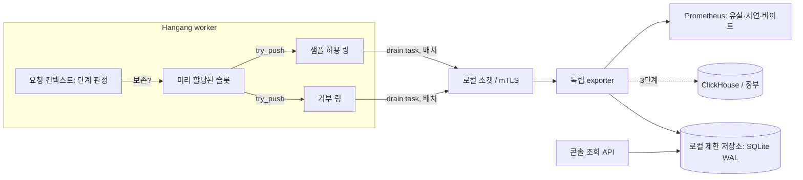

# ADR 0019: 판정 이벤트 스키마와 제한된 exporter

[English](../adr/0019-decision-events-exporter.md)

상태: **아키텍처 채택 — 2026-10-18**.
[로깅·모니터링 설계](OBSERVABILITY.md)와 ADR 0004를 요청별 접근 판정이라는 한 가지
이벤트 종류에 대해 구체화하며, [ADR 0020](0020-unified-console-redesign.md) 콘솔
재설계의 데이터 전제입니다.

> 채택 기록(사용자 재개 지시, 2026-10-18): 명시한 소유 경계와 상한·실패 시 거부하는
> 설계를 채택합니다. 구현은 서로 다른 미병합 검토 단위에 있으며 채택은 구현 완료·출시·배포·
> 보존 정책 활성화·conformance 주장이 아닙니다. 아래 배경은 설계 당시의 기준선입니다.
> 미결 질문과 단계별 인수 게이트는 백로그로 유지합니다.
> [현재 로드맵](ENTERPRISE_ROADMAP_2026-10-18.md)을 참고하세요.

## 배경

한강은 보호 요청마다 이미 여러 권한 주체의 판정을 집행합니다. HGD1/gRPC로 수문장
(Guard) 네트워크 증거, HOP1/gRPC로 호패 신원 검증, PPG1/gRPC로 품계 인가(observed
permit 포함), 그리고 한강 자신의 라우트 해석·의무(obligation)·최종 소유자/리비전
fence입니다. 각 권한 주체는 자기 기록(수문장 위협 후보·차단, 호패 인증 이벤트, 품계
게시 감사, 호스트 플러그인 journal)을 갖지만 **한 요청의 단계를 묶는 기록은 없습니다**.
설계상 요청 로그를 보존하지 않았고 OBSERVABILITY.md의 exporter도 아직 제안 단계입니다.

그래서 콘솔은 상용 제로트러스트 제품(Cloudflare Zero Trust 접근 로그, Okta System
Log, Teleport 감사, Tailscale ACL 테스트)에서 운영자가 가장 먼저 묻는 질문, 즉 *누가,
어디서, 어느 권한 주체의 어떤 규칙·리비전으로 거부되었고, 이 정책을 바꾸면 어떻게
되는가*에 답하지 못합니다. 콘솔 검토 결과 구성요소를 가로지르는 판정 로그, 요청 상세,
what-if 시뮬레이터가 없고 이를 만들 데이터도 없습니다.

## 결정

1. 한강은 아래 샘플링 규칙으로 보존되는 **보호 요청 집행마다 판정 이벤트 하나**와
   관리자 **시뮬레이션**마다 하나(표시됨)를 발행합니다. 모든 단계와 최종 집행 결과를
   보는 유일한 지점이므로 게이트웨이 트래픽의 유일한 발행자는 한강입니다. 권한 주체는
   같은 판정의 요청별 사본을 중복 발행하지 않습니다.
2. 이벤트는 **순서가 있는 단계별 판정 목록**과 질의한 모든 권한 주체의 **리비전
   벡터**를 담습니다. 헤더·본문·쿼리 문자열·쿠키·자격증명·receipt·permit·프로바이더
   토큰은 절대 담지 않습니다.
3. subject와 클라이언트 IP는 **회전하는 키 기반 HMAC으로 가명화**합니다. 봉인(sealed)
   사본은 `standard` 개인정보 프로필에서만 존재하고, epoch 키가 있는 동안만 복호화되며,
   감사되는 특권 콘솔 작업으로만 공개됩니다.
4. 발행은 **제한된 메모리 링**에 대한 비차단 `try_push`이며 **독립 exporter**가 이를
   비웁니다. 유실은 집계하되 기다리지 않습니다. 요청 경로에는 I/O, 미리 할당된 슬롯 외
   할당, 분석 호출이 없습니다.
5. 첫 저장소는 exporter가 소유한 **로컬 제한 저장소**(바이트/기간 상한이 있는 WAL 모드
   SQLite)이며 콘솔 조회 API를 제공합니다. ClickHouse 또는 장부(Jangbu)는 같은 exporter
   뒤의 후속 sink이며 어느 것도 정책 권한 주체가 아닙니다.
6. 시뮬레이션(explain/what-if)은 판정을 이벤트 저장소에서 읽지 **않습니다**. 각 권한
   주체의 관리자 explain API로 현재 또는 후보 상태를 dry-run합니다. 이벤트 저장소는
   영향 추정용 과거 트래픽만 제공합니다.

## 이벤트 스키마 (`hangang.decision.v1`)

전송 형식은 길이 구분 배치의 버전 있는 protobuf 메시지
(`hangang.decision.v1.DecisionEvent`)이고, 아래 JSON은 콘솔 API 투영입니다. 알 수 없는
enum 값은 `unspecified`로 해석해 *알 수 없음*으로 표시하며 허용으로 표시하지 않습니다.
인코딩된 이벤트는 2 KiB 이하이고 모든 목록은 고정 최대값과 `truncated` 표시를 갖습니다.

```json
{
  "schema": "hangang.decision.v1",
  "event_id": "01JA9Q4Z8M3V7T2C6R1K5N0PXE",
  "kind": "enforced",
  "request_id": "hg-7f3a9c2e41d08b65",
  "time": "2026-10-16T09:12:44.512Z",
  "emitter": {"component": "hangang", "instance": "gw-a", "build": "0.3.12"},
  "route": {"listener": "https-443", "host": "app.example.test", "route_id": "app-api",
            "path_template": "/api/reports/{id}", "method": "GET",
            "service": "reports", "resource": "report", "action": "read"},
  "outcome": {"result": "deny", "status": 403, "deciding_stage": "authorization",
              "reason": "pumgye.class_denied"},
  "stages": [
    {"stage": "network", "authority": "sumunjang", "verdict": "allow", "mode": "enforce",
     "rules": ["asn-allow-corp"], "revision": 418, "latency_us": 41,
     "transport": "hgd1", "client": {"ip_ref": "ip~4MZQ7K2V9B", "prefix_ref": "pfx~Q1W8",
     "asn": 64500, "country": "KR"}},
    {"stage": "identity", "authority": "hopae", "verdict": "authenticated",
     "subject_ref": "sub~7HC2LQ0D5E", "principal": "human", "provider": "oidc-corp",
     "aal": 1, "factors": ["federated"], "session_ref": "ses~K93TT0",
     "generation": 5521, "latency_us": 183, "transport": "hop1"},
    {"stage": "authorization", "authority": "pumgye", "decision": "ClassDenied",
     "roles": ["analyst"], "information_class": "restricted", "required_aal": 2,
     "revision": 77, "permit": null, "latency_us": 22, "transport": "ppg1"},
    {"stage": "enforcement", "authority": "hangang", "action": "refused",
     "obligations": [], "fence": "ok", "revision": 268}
  ],
  "revisions": {"hangang": 268, "sumunjang": 418, "hopae": 5521, "pumgye": 77,
                "catalog": 12},
  "sampling": {"class": "deny", "rate": 1.0},
  "privacy": {"profile": "standard", "key_epoch": "2026-10-16"}
}
```

### 공통 필드

| 필드 | 의미 |
| --- | --- |
| `event_id` | 발행자가 만든 정렬 가능한 128비트 ID. at-least-once 전달의 중복 제거 키 |
| `kind` | `enforced`, `simulation`(관리자 dry-run, 집행 안 함), `shadow`(실트래픽과 함께 후보 평가, 집행 안 함) |
| `request_id` | 한강 요청 ID. 거부/추가인증 화면에서 지원 참조번호로 보일 수 있음(ADR 0020) |
| `time` | 발행자 벽시계 기준 수락 시각. 단계 순서와 지연은 한강 단조 시계를 쓰며 ADR 0018에 따라 권한 주체 시계와 비교하지 않음 |
| `route` | 라우트/리스너/호스트와 **경로 템플릿**. 원본 경로·쿼리는 담지 않음. 서비스/자원/행위는 한강·카탈로그가 해석한 값 |
| `outcome` | 최종 결과 `allow`, `deny`, `challenge`, `error`, `unavailable`, HTTP 상태, 결정 단계, 안정적인 네임스페이스 사유 코드 |
| `revisions` | 리비전 벡터: 한강 설정 리비전, 수문장 정책 리비전, 호패 상태 세대, 품계 정책 리비전, 카탈로그 번들 리비전. 없는 항목은 0이 아니라 미질의 |

### 단계 판정

단계는 평가 순서대로 나타납니다. 도달하지 않은 단계는 생략하고 결정 단계가 그 이유를
설명합니다. 동시에 질의한 단계는 각자의 지연을 기록합니다.

| 단계 | 권한 주체 | 필드 |
| --- | --- | --- |
| `network` | 수문장 | `verdict`(`allow`, `deny`, `observe`, `unavailable`; 품계 `GuardEvidence`와 대응), `mode`(`observe`/`enforce`), 일치 규칙/차단 ID(≤8), 정책 리비전, IP·프리픽스 가명 참조, ASN, 국가 |
| `identity` | 호패 | `verdict`(`authenticated`, `anonymous`, `challenge`, `denied`, `unavailable`), subject·세션 가명 참조, 주체 종류(`human`, `service`, `workload`), 프로바이더 ID, AAL, 인증요소 enum(≤6), 상태 세대 |
| `authorization` | 품계 | `decision`은 `pumgye_core::Decision`의 정확한 변형: `Allow`, `UnknownService`, `Guest`, `NetworkGuest`, `PermissionDenied`, `ClassDenied`, `AssuranceDenied`, `GuardDenied`, `GuardUnavailable`; 일치 역할(≤8), 정보등급, 요구 AAL, 정책 리비전, 발급된 경우 observed permit 다이제스트 접두 |
| `enforcement` | 한강 | `refused`, `challenged`, `forwarded`, `redirected`; 적용된 의무(예: ADR 0014 자격증명 투영 계약, ≤8); 최종 fence 결과(`ok`, `stale_owner`, `revision_regressed`, `expired`); 전달된 경우 업스트림 상태 등급 |

사유 코드는 네임스페이스(`sumunjang.*`, `hopae.*`, `pumgye.*`, `hangang.*`)를 갖고
en/ko 메시지 키와 함께 등록합니다(ADR 0020). 품계 `Decision` 변형이나 사유 코드를
추가하려면 스키마 minor 버전, 메시지 키, 계약 테스트가 필요합니다.

## 개인정보

"요청 로그를 보존하지 않는다"는 원래 요구는 **트래픽**에 대해 그대로 유지됩니다.
접근 로그, 파라미터가 포함된 URL, 헤더·본문은 저장하지 않습니다. 이 ADR은 제한되고
가명화되었으며 설정·비활성화 가능한 **접근 판정** 기록을 추가합니다. 집행 결과를
운영자에게 설명하는 데 필요한 최소 데이터입니다.

- **가명.** `ip_ref`, `prefix_ref`(IPv4 /24, IPv6 /48), `subject_ref`, `session_ref`는
  `HMAC-SHA-256(epoch_key, domain || value)`를 80비트로 자르고 종류 접두어를 붙인
  base32입니다. 도메인 분리로 종류 간 결합을 막습니다.
- **키 epoch.** 기본 24시간 회전(1시간–30일 설정). 키는 한 배포의 모든 한강 복제본이
  공유하는 비밀 참조이므로 노드 간 가명이 일치합니다. epoch의 마지막 이벤트가 만료되면
  키를 파기하고, 그 이후 해당 epoch의 가명은 사람과 연결할 수 없습니다(crypto-shredding).
- **봉인 필드(`standard` 프로필, 기본값).** 호패 불투명 subject ID와 클라이언트 IP를
  epoch 키로 AEAD 봉인해 추가로 담습니다. 기본적으로 ClickHouse/장부로 내보내지 않습니다.
  `decisions:reveal` 권한 콘솔 역할은 해석된 신원을 보며, 봉인값을 푼 목록/상세 응답마다
  감사 기록 하나(행위자, 질의 다이제스트, 건수)를 남깁니다. IP 공개는 별도
  `network:reveal-ip` 권한입니다.
- **`strict` 프로필.** 봉인 필드가 없습니다. 정방향 조회만 가능합니다. 사용자 상세에서
  조회 서비스가 보존 중인 epoch들의 해당 사용자 가명을 계산해 검색하며, 역방향 해석은
  설계상 불가능합니다.
- **`off` 프로필.** 판정 이벤트가 없습니다. 콘솔은 판정 로그를 *비어 있음*이 아닌
  *비활성*으로 표시하고, 시뮬레이션은 실시간 explain을 쓰므로 계속 동작합니다.
- **보존.** 로컬 저장소 기본 7일·2 GiB 중 먼저 도달하는 한도, 절대 최대 90일. sink별
  보존은 독립적이며 문서화합니다.
- **항상 제외.** 헤더, 쿠키, 본문, 쿼리 문자열, 원본 경로, receipt, permit, 세션 토큰,
  프로바이더 토큰, 이메일, 표시 이름, Lua 소스.
- 지표는 OBSERVABILITY.md대로 낮은 카디널리티를 유지하며 label에 가명을 넣지 않습니다.

## 샘플링

헤드 샘플링은 `request_id`에 대해 결정적이므로 모든 복제본과 단계가 일치합니다.

| 등급 | 기본값 | 규칙 |
| --- | --- | --- |
| 거부, 추가인증, 오류, 불가 | 100% | (라우트, `prefix_ref`)별 토큰 버킷 적용. 초과분은 버킷 창마다 건수와 처음/마지막 시각을 담은 `suppressed` 요약 이벤트 하나 |
| 허용 | 1% | 라우트별 0–100% 설정. `audit_all` 라우트(예: 관리 API, `restricted` 등급)는 기본 100% |
| 추적 | 대상 100% | 사용자·라우트·프리픽스 하나에 대한 시간 제한(≤60분) 운영자 추적. `decisions:trace` 권한과 사유가 필요하며 감사됨 |
| 시뮬레이션/shadow | 100% | 별도 파티션에 저장하고 트래픽 집계에서 제외 |

콘솔의 허용 건수는 샘플 비율에서 도출한 **추정치**로 표시합니다. 정확한 요청 수는
계속 권한 있는 Prometheus 카운터에서 가져옵니다.

## 전송과 exporter



- 단계 판정은 이미 요청 컨텍스트에 있으므로 기록 비용은 고정 크기 쓰기 몇 번입니다.
  이벤트는 보존될 때만 구성합니다.
- 워커마다 제한된 링 두 개(기본 거부 8,192, 허용 4,096 슬롯)를 두어 허용 폭주가 거부를
  밀어내지 못하고 거부 폭주는 토큰 버킷으로 제한됩니다. 링이 가득 차면
  `hangang_decision_events_dropped_total{class}`를 증가시킵니다.
- drain task가 최대 512개 이벤트 또는 250 ms 단위로 묶어 로컬 Unix 소켓 또는 mTLS로
  exporter에 보냅니다. exporter가 내려가면 링이 차고 유실됩니다. 한강에는 **디스크
  spool이 없고** 요청 스레드에서 재시도하지 않습니다.
- exporter는 별도 프로세스(ADR 0004)로, 제한된 수신, 자체 저장소 자격증명을 가지며
  **정책 변경 자격증명은 없습니다**. `event_id` 고유성으로 로컬 저장소에 쓰고(at-least-once
  안전) 파티션 단위 삭제로 기간/바이트 상한을 강제합니다. 후속 sink는
  OBSERVABILITY.md대로 확인된 INSERT를 사용합니다.
- 구성요소 자체 이벤트는 소유자가 그대로 보관합니다(호패 인증 이벤트, 수문장 후보,
  품계 감사, 호스트 플러그인 journal). 판정 이벤트는 필요 시 ID로 참조하고, 콘솔은 이를
  공유 다중 작성자 스키마로 복사하지 않고 연합 조회합니다. 한강을 거치지 않는 판정
  (ADR 0015/0016의 Kubernetes TokenReview/SubjectAccessReview)은 판정한 권한 주체가 같은
  스키마로 `emitter.component`를 지정해 발행합니다(3단계).

성능 예산: 허용 1% 샘플링으로 초당 10만 판정에서 이벤트 수집과 drain의 총 CPU 부가
비용 2% 이하, `off` 대비 측정 가능한 p99 지연 증가 없음(≤5 µs). 이는 검증 목표이지
달성 주장이 아닙니다.

## 가능해지는 콘솔 API

exporter의 읽기 전용 조회 서비스가 한강 호스트 broker를 통해 제공하며, 콘솔 권한별로
인가되고 모두 제한됩니다(페이지당 ≤200행, 창 ≤31일, 기한 3초, cursor 페이지네이션).

| API | 목적 |
| --- | --- |
| `GET /v1/observability/decisions` | 서버측 필터·정렬·페이지네이션 판정 로그: 시각, 결과, 결정 단계, 사유, 라우트, 서비스, 자원, 등급, subject, IP/프리픽스, ASN, 국가, 주체 종류, 리비전 |
| `GET /v1/observability/decisions/facets`, `/timeseries` | 개요 타일·차트용 결과/사유/라우트/단계별 건수 |
| `GET /v1/observability/requests/{request_id}` | 요청 상세: 한 요청의 모든 이벤트(재시도 포함)를 단계 순으로 |
| `POST /v1/observability/reveal` | 제한된 event ID 집합에 대한 명시적·감사되는 봉인 해제 |
| `POST /v1/explain` | 한강이 조율하는 시뮬레이션(아래) |
| `POST /v1/observability/impact` | 보존된 과거 컨텍스트를 후보 정책으로 재평가 |

**Explain/시뮬레이션.** 입력: 호스트/메서드/경로 또는 서비스/자원/행위, subject(호패
사용자 ID 또는 익명), 주체 종류, 선택적 가정 AAL/인증요소, 클라이언트 IP, 시각. 한강이
현재 또는 후보 설정으로 라우트를 해석한 뒤 각 권한 주체의 관리자 explain을 동시에
호출합니다.

- 수문장: 기존 `lookup`/`networks/inspect`를 후보 정책 문서 참조를 받도록 확장.
- 호패: 신규 `POST /v1/admin/explain/authentication`. subject 상태, 프로바이더, 프로필,
  달성 가능한 AAL을 반환하며 세션을 만들거나 건드리지 않음.
- 품계: 신규 `POST /v1/explain`. 게시 또는 후보 정책에 대해 `Decision` 변형, 일치/부족한
  역할·할당, 등급·AAL 요구, 리비전을 반환. permit을 발급하지 않고 아무것도 쓰지 않음.

각 응답에는 평가한 리비전이 표시됩니다. 결과는 `simulation` 이벤트로 저장되고 감사됩니다.
시뮬레이션은 행위자별 속도 제한을 받으며 자격증명·permit·세션·정책 변경을 만들 수
없습니다.

**영향(what-if).** 품계 또는 수문장 후보 정책에 대해, 조회 서비스가 선택한 기간의 보존
컨텍스트(subject/라우트/등급별 중복 제거)를 권한 주체의 배치 explain으로 흘려보내고
결과가 바뀐 건(허용→거부, 거부→허용)의 수와 예시를 보고합니다. 샘플 허용에 기반한
결과는 추정치로 표시하며 strict 프로필의 영향 분석은 가명 컨텍스트만 사용합니다.

## 검토한 대안

- **전체 접근 로그.** 기각: 트래픽 보존 요구와 충돌하고 공격 시 무제한이며 민감 URL이
  관리 저장소에 섞입니다.
- **각 권한 주체가 요청별 이벤트를 내고 콘솔이 결합.** 기본 경로로는 기각: 어느 권한
  주체도 최종 집행을 보지 못하고 시계 영역이 다르며 sink 간 요청 ID 결합은 취약·중복적.
- **요청마다 ClickHouse/SQLite 동기 쓰기.** ADR 0004와 고속 경로 불변식으로 기각.
- **IP/subject 단순 해시.** 기각: 솔트 없는 IPv4 해시는 쉽게 역산되고 키 없는 해시는
  만료되지 않습니다.
- **Prometheus 지표만.** 불충분: 요청별 설명이 없습니다.
- **로그 재생으로 시뮬레이션.** 판정에 대해서는 기각: 로그는 샘플이고 과거이므로
  explain은 실시간 권한 코어를 써야 합니다.

## 결과

- 운영자는 상용 제품 수준의 구성요소 간 판정 로그, 요청 타임라인, 시뮬레이션, 영향
  분석을 명시적이고 제한되며 검토 가능한 개인정보 정책 아래에서 얻습니다.
- 새 exporter 프로세스, 저장소, 키 epoch 비밀, 세 권한 주체의 신규 explain 엔드포인트를
  구현·보안·검증해야 합니다.
- 극단적 폭주 시 일상 허용 이벤트와 초과 거부는 유실·요약됩니다. 로그는 증거이지 완전한
  회계가 아닙니다.
- 스키마 변화가 계약 테스트를 통해 권한 주체의 사유 어휘와 콘솔 메시지 카탈로그를
  결합합니다.

## 단계별 도입

| 단계 | 산출물 | 수용 기준 |
| --- | --- | --- |
| D0 | protobuf 스키마, JSON 투영, 사유 레지스트리, 유효/거부 fixture | 과대 목록·알 수 없는 enum·원본 IP/이메일/경로 주입 거부 fixture; EN/KO 키 100% |
| D1 | 한강 수집·링·drain, exporter, 로컬 저장소, decisions/requests/facets API, `strict`/`standard`/`off` | 10k/100k QPS 부가비용 예산 이내; exporter 장애 시 제한된 유실·지연 변화 없음; 거부 폭주가 버킷으로 제한; 키 회전 후 과거 가명 연결 불가; 내보낸 바이트에 봉인값 없음 |
| D2 | 품계 `/v1/explain`, 호패 explain, 수문장 후보 lookup, `/v1/explain`, 영향, 추적 | 같은 스냅샷에서 모든 `Decision` 변형의 explain·집행 일치; 시뮬레이션이 permit/세션을 발급하지 않음; 모든 simulate/reveal/trace 감사 |
| D3 | ClickHouse/장부 sink, 구성요소 발행 Kubernetes 판정, 장기 분석 | 확인된 INSERT, 중복 재전송, sink 장애, 보존 강제, 테넌트 격리 |

## 미결 질문

1. 스케일아웃 멤버십(ADR 0013)에서 키 보관: 설정 비밀 참조로 epoch 키를 배포할지,
   KMS에서 epoch별로 도출할지?
2. 거부 화면에 `request_id`를 최종 사용자에게 기본 노출할지, 라우트별로 할지?
3. 법·지역별 보존 기본값과 `standard`를 기본으로 유지할지 여부.
4. 장기 sink 소유자를 장부로 할지 ClickHouse 직접으로 할지.
5. 멀티테넌트 파티셔닝과 판정 조회의 테넌트별 콘솔 범위.
6. 시뮬레이션을 승인 워크플로(직지/Jikji)의 증거로 인용할 수 있도록 품계가 explain
   결과에 서명해야 하는지.
